# ds-sync architecture

How the tool works today (November 2026): what each part does, how data flows from Figma to a tested Storybook, and how the pull-request loop keeps it in sync. For goals, status and next steps see [PLAN.md](PLAN.md); for the original product strategy (written before the build) see [docs/STRATEGY.md](docs/STRATEGY.md).

## 1. The big picture

ds-sync reads a Figma design system through the Figma REST API and **generates** a complete Storybook project from it: design tokens, components, stories with interaction and accessibility tests, and docs pages. It generates the same design for two kinds of team: native React, and framework-agnostic Web Components (Lit) for Vue, Angular, Svelte or plain HTML. Then it keeps that project in step with Figma through reviewed pull requests.

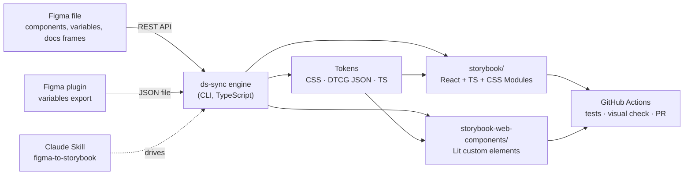

Four ways in, one engine:

| Entry point | Who uses it | What it does |
| --- | --- | --- |
| `engine/` CLI (`ds-sync`) | Developers, CI | All the work: discover, extract, generate, check, diff |
| `skills/figma-to-storybook` | Claude, on a person's behalf | Runs the CLI and asks the questions only a person can answer (what a component should do, whether to accept a design issue) |
| `.github/workflows/ds-sync.yml` | The repository, every weekday | Polls Figma, regenerates, tests, compares with Figma, opens a labelled pull request |
| `plugin/` (Figma plugin) | Designers on non-Enterprise plans | Exports Figma variables to JSON, because the Variables REST API is Enterprise-only |

**Principles behind the design**

- **Deterministic core.** Everything that can be computed from Figma is computed, the same way every time. No AI calls inside the engine.
- **Generated folders are owned by the tool.** `src/`, `.storybook/` and `types/` in each output are rebuilt on every run. To change the output, change Figma, the config overrides or the generator, never the files.
- **Say what Figma does not specify.** Behaviour, accessible names and anything assumed is written to `GENERATION-REPORT.md` and each docs page, instead of being invented silently.
- **Changes arrive as pull requests**, reviewed by a person.

## 2. Repository layout

| Path | Role |
| --- | --- |
| `engine/src/cli.ts` | Commands: `init`, `discover`, `generate`, `status`, `changes`, `visual`, `outputs`, and the older drift-report steps |
| `engine/src/figma/` | REST client: auth, on-disk response cache, retries (429 with Retry-After, 5xx, network), images and binary downloads |
| `engine/src/discover/` | Finds every component set, classifies pages and frames, proposes a template per component |
| `engine/src/ir/` | Builds the **IR** (intermediate representation): a normalised, framework-neutral model of each component set |
| `engine/src/generate/tokens.ts` | Figma variables → tokens (CSS custom properties, W3C DTCG JSON, typed TS) and value-to-token matching |
| `engine/src/generate/styles.ts` | The **style compiler**: per-variant Figma styles → the smallest CSS that reproduces them |
| `engine/src/generate/templates/` | React templates: `action` (Button), `checkbox`, `accordion`, and `generic` with its behaviour packs (switch, radio, input, dialog) |
| `engine/src/generate/wc/` | Web Components (Lit) renderers that reuse each template's model, plus the WC project scaffold |
| `engine/src/generate/project.ts` | React project scaffold: package.json, Storybook config, test config per Figma mode, layout helpers |
| `engine/src/visual/` | `ds-sync visual`: Figma renders vs Storybook screenshots, pixel diff, HTML report |
| `engine/src/changes/` | `ds-sync changes`: what changed in Figma between two versions, PR labels, before/after renders |
| `engine/archetypes/` | Behaviour contracts per archetype (role, required states, keyboard) |
| `engine/templates/github-workflow.yml` | The CI workflow that `ds-sync init --ci` installs |
| `engine/test/` | 64 engine tests against recorded Figma fixtures (no token needed) |
| `storybook/`, `storybook-web-components/` | Example outputs generated from the "Design system AI" Figma file |
| `ds-sync.config.json` | Config for this repo's example: Figma file, targets, mode attributes, overrides, accepted design issues |

## 3. Generation pipeline

`ds-sync generate` runs these stages. Every Figma response is cached under `.ds-sync/cache`, so a second run with the same Figma version makes no network calls.

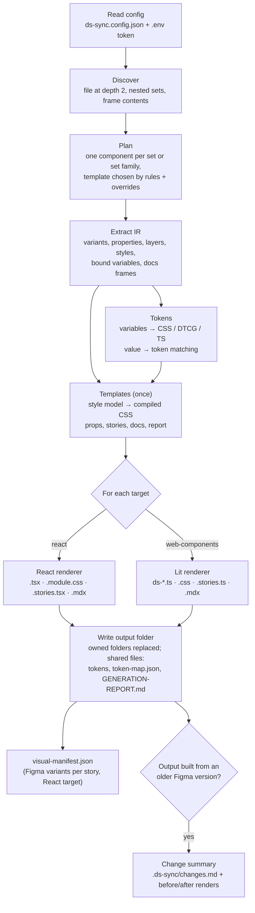

Key point: **the CSS is computed once per component and shared by both targets**, so React and Web Components look identical by construction. Only the markup and behaviour layer differs.

### 3.1 Discovery and template choice

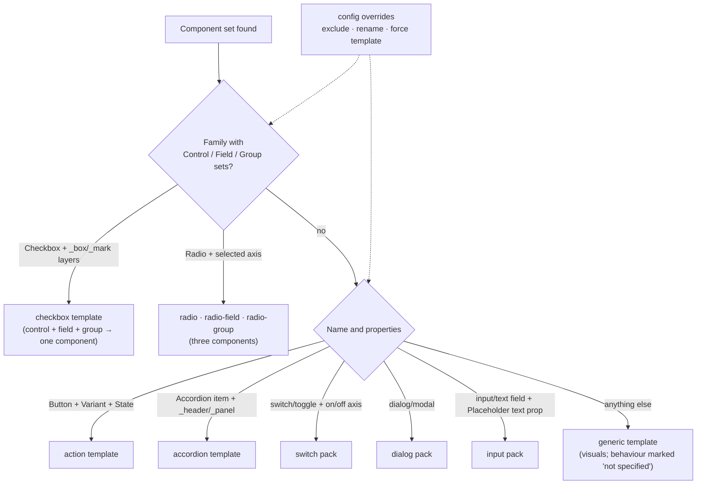

Sets are found three ways: top-level sets from the depth-2 file read, nested sets that Figma's set list names (by id), and sets deep inside page frames, found by reading every non-documentation frame breadth-first and reading again where Figma cut a frame off at the depth limit (Blade keeps its sets six levels down). Internal pages (`_…`), deprecation pages and sets named DEPRECATED / DO NOT USE / Old are left out unless an override names them.

Discovery also classifies every top-level frame as documentation, example, page text or other. Low-confidence classifications go to `.ds-sync/discovery.md` under "Needs a person", which the Claude Skill walks through with the user.

### 3.2 The IR

The IR (`engine/src/ir/types.ts`) is the boundary between Figma and the generators. Nothing after it reads Figma JSON.

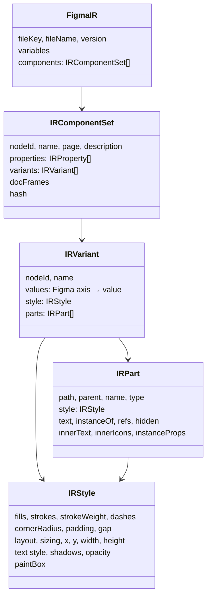

Details that matter:

- Every value keeps its **bound variable id**, so a colour bound to a Figma variable becomes a token, not a hex value.
- Instances are flagged as **icons** when their component is named "Icon/…" or is a small square standalone component made only of shapes (design systems that name icons `search`, `arrow-right`). Icons are exported as SVG.
- True/False variant properties become **boolean props**; `isDisabled` (or `disabled`) becomes the disabled state.
- Repeated sibling layers with the same name get distinct paths (`field`, `field#2`). Repeated component instances keep one path and render as copies.
- Linear gradients become CSS `linear-gradient`. Dashed strokes keep Figma's dash pattern. `paintBox` records how far shadows paint outside the frame (used by the visual check).
- Each set has a content `hash`, so unchanged sets are skipped when diffing versions.

### 3.3 The style compiler

`engine/src/generate/styles.ts` turns per-variant Figma values into compact CSS. A template describes its **style model**: the roles (root and layers), the variant axes that become `data-*` attributes, and the state axes that become selectors.

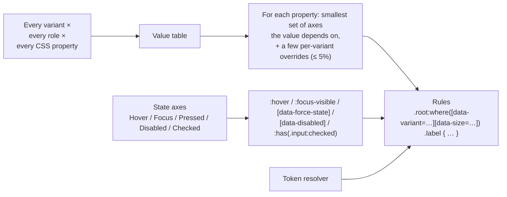

- Padding that only varies by Size becomes three rules, not hundreds.
- `:where()` keeps specificity flat, so source order decides and overrides stay predictable.
- `data-force-state` renders pseudo states statically, so stories can show Hover and Focus side by side.
- Fidelity rules learned from the visual check: CSS `order` where Figma reorders layers between variants; layers missing from a variant are hidden; single-line text gets Figma's rounded text-box height as a minimum; boxes around nested components carry layout only (the component paints itself).

### 3.4 Tokens and Figma modes

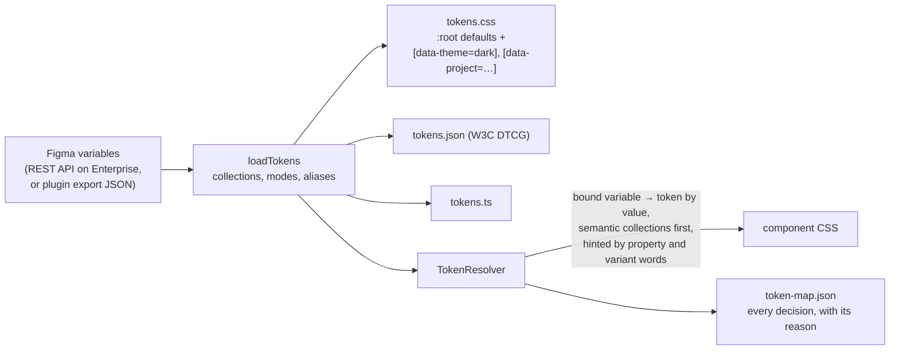

Figma modes (light/dark, brands) become attributes on `<html>`. Storybook has a toolbar for each; the story tests run once per mode (section 5).

### 3.5 Templates and behaviour packs

| Component | Template | Behaviour (WAI-ARIA pattern) |
| --- | --- | --- |
| Button | `action` | Native `<button>`; Enter/Space; icon slots |
| Checkbox | `checkbox` | Native checkbox in a field; group as `<fieldset>`; indeterminate, invalid, read-only |
| Accordion | `accordion` | Disclosure headers; arrow keys, Home/End; single or multiple expand |
| Switch | `generic` + switch pack | `<button role="switch" aria-checked>`; Space/Enter; loading = `aria-busy` |
| RadioControl / Field / Group | `generic` + radio packs | Native radios; field row is a `<label>`; `radiogroup` with shared name and value; arrow keys |
| Input | `generic` + input pack | Native `<input>` replaces the placeholder layer; `<label>`, `aria-describedby`, `aria-invalid`, clear button |
| Dialog | `generic` + dialog pack | Native `<dialog>`, `showModal()`; Escape; focus return; `alertdialog` for Alert |
| Everything else | `generic` | Visuals from the layer tree; behaviour listed as not specified |

The **generic template** renders any component set from its layers. Variant axes become props; boolean properties toggle layers; text properties fill text layers; nested instances render the generated component; icons are the exported Figma SVGs. Text and icons that Figma swaps per variant become small lookups (for example "Loading…" when State=Loading, otherwise the label for that Type).

**Behaviour packs** add behaviour on top of the generic visuals instead of being separate templates. They find the layers they need by the Figma properties bound to them (for example the text layer bound to a "Placeholder" property becomes the `<input>`), so they work across design systems with different layer names.

## 4. Two targets from one model

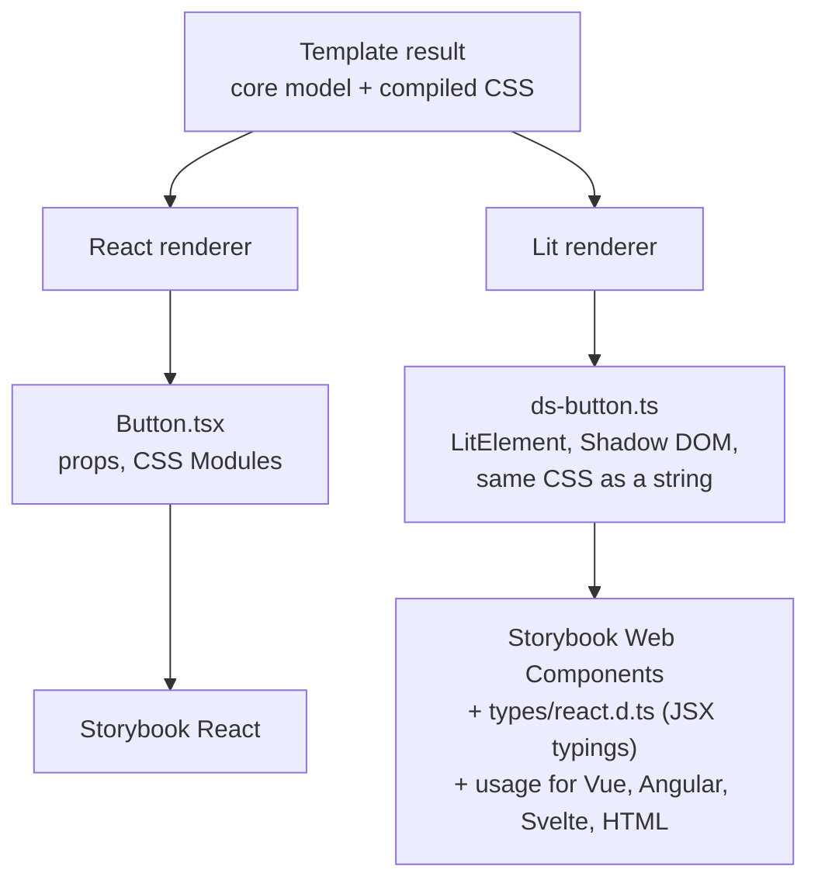

Web Components specifics:

- Form controls (Button, Checkbox, Switch, Radio, Input) are **form-associated** through `ElementInternals`, so they submit with a `<form>`.
- `delegatesFocus` passes focus into the shadow root; events that must leave it (`change`, `open-change`, `value-change`) are composed.
- Native radios cannot group across shadow roots, so `<ds-radio-group>` collects its radios from a composed `ds-radio-register` event and does the grouping itself (one selected, arrow keys, one Tab stop).

`ds-sync init` detects the stack and suggests targets: React apps get `react`; Vue, Angular, Svelte, Lit or no framework get `web-components`; React monorepos get both.

## 5. What a generated project contains, and how it is tested

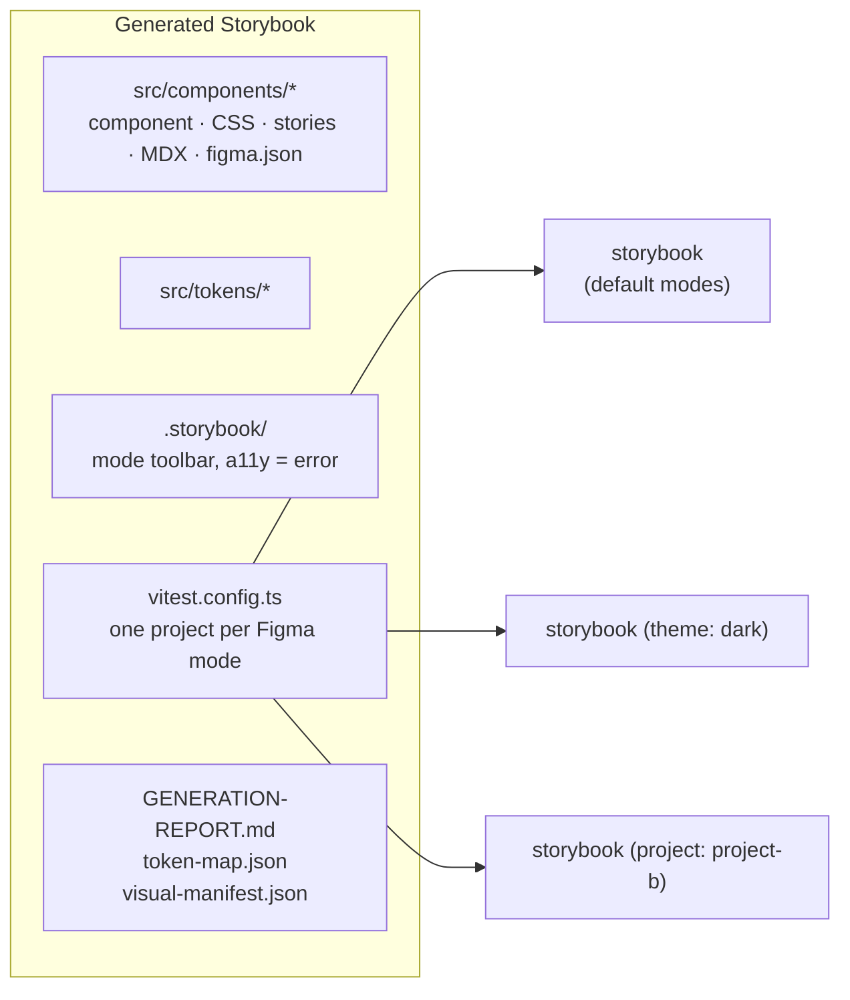

- **Every story is a test** (Storybook's Vitest addon, Playwright Chromium): it must render, its play function must pass (click, keyboard, ARIA state), and axe must find no accessibility violations.
- **Every Figma mode is tested.** The same stories run once with the default modes and once per other mode, so contrast is checked in dark mode and every brand. The mode reaches the preview through `VITE_DS_MODES`.
- **Accepted design issues** (`overrides.knownIssues`) turn axe failures into reports, per component and optionally per mode (`"theme=dark": "reason"`). Every other mode stays strict.
- Each component also has a hidden **Figma Variants** story: every Figma variant once, at its Figma width, for the visual check. It is excluded from the tests.

Current example result: 258 of 258 story tests pass in both outputs across all modes.

## 6. Visual check against Figma

`ds-sync visual` answers "does the code look like Figma?" for every variant.

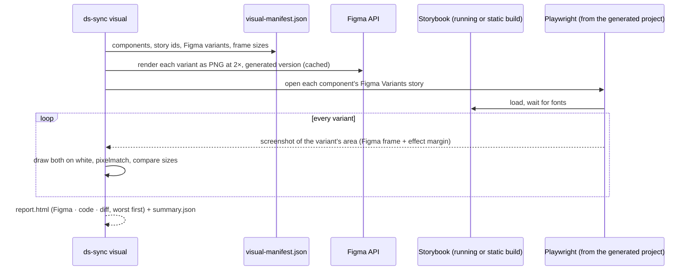

Grades: **match** (≤ 2% of pixels and the same size ±1px), **check** (≤ 10%, or a size difference only), **differs** (> 10%). Current example: 1,340 variants across all 21 components: 910 match, 358 check (font anti-aliasing, Figma's rounded text widths, fixed-size specimen frames), 72 differ (1px dashed Divider lines, sub-pixel snapping). The check found and drove fixes for eleven real generator bugs (listed in PLAN.md, Phase D).

## 7. Keeping it in sync: the pull-request loop

### 7.1 What changed in Figma

`ds-sync changes` (and `generate`, when the output came from an older Figma version) compares two Figma versions:

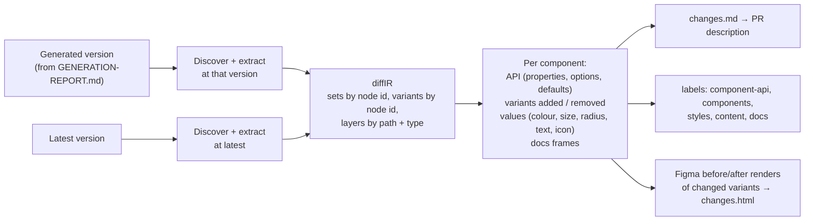

Identical changes across variants are grouped ("3 of 90 variants: fill `#dc2626` → `#1ec857`").

### 7.2 The GitHub workflow

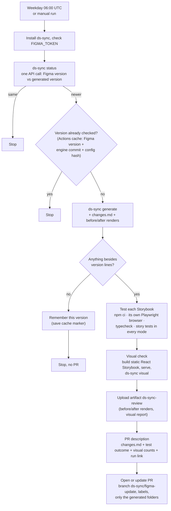

Verified on GitHub: the polling path, the version-only path (no pull request) and the cache path (the next run stops after the version check). The full path to a pull request has been exercised end to end once before these additions (pull request #1, a Button colour edit); the summary, labels, images and visual step in that path are tested locally.

## 8. Figma API usage and caching

| Call | Used by | Notes |
| --- | --- | --- |
| `GET /v1/files/:key?depth=1` | `status` | One call per scheduled run when nothing changed |
| `GET /v1/files/:key?depth=2` (+ `ids=`) | discover, extract | Pages, top-level sets; nested sets by id |
| `GET /v1/files/:key/nodes?ids=…` | discover, extract | Set contents in batches of 25 |
| `GET /v1/images/:key` (SVG) | generate | Icons, outlined, colours replaced by `currentColor` |
| `GET /v1/images/:key` (PNG, 2×) | visual, changes | Variant renders, batches of 50 |
| `GET /v1/files/:key/variables/local` | generate | Enterprise only; otherwise the plugin export is used |

All requests pass `version=` when a version is pinned (`--figma-version`), so runs are reproducible. Responses are cached by URL in `.ds-sync/cache`; `--refresh` bypasses the cache. Rate limits (HTTP 429) are retried after `Retry-After`; 5xx and network errors back off 2 s, 6 s, 18 s.

## 9. Configuration

`ds-sync.config.json` (full reference: [skills/figma-to-storybook/reference/config.md](skills/figma-to-storybook/reference/config.md)):

```jsonc
{
  "figma": { "fileKey": "…" },
  "generate": {
    "mode": "auto",                       // discover components automatically
    "targets": [
      { "target": "react", "outDir": "storybook" },
      { "target": "web-components", "outDir": "storybook-web-components", "packageName": "…" }
    ],
    "tagPrefix": "ds",                    // <ds-button>
    "variablesExport": "engine/inputs/figma-variables.json",
    "modeAttributes": { "semantic.color": "data-theme", "primitives.color": "data-project" },
    "overrides": {
      "sets": { "Toggle": { "template": "switch" } },
      "skipPages": [],
      "knownIssues": { "Badge": { "theme=dark": "text #111827 on badge colours is 1.72–3.53:1" } }
    }
  }
}
```

The token lives in `.env` (`FIGMA_TOKEN=…`), which `init` adds to `.gitignore`; in CI it is the `FIGMA_TOKEN` repository secret.

## 10. Known limits

- Behaviour exists only for the archetypes above; other interactive components are visuals only and say so.
- Figma does not specify accessible names for icon-only controls; names taken from layer names are flagged for confirmation.
- The generated folders are owned by ds-sync. Updating code that people edit by hand (a three-way merge) is not built.
- Two design systems have been tested: "Design system AI" and Blade (108 components). Behaviour templates match the first file's naming best; Blade's checkbox, radio, button and accordion sets are generated as visuals.
- The package is ready but not published to npm yet (`release.yml` publishes on a version tag); the sync workflow builds the engine from this repository until then.
- The deep discovery scan is slow on very large files (Blade: about 25 minutes uncached) because of Figma's rate limit.
- Visual differences that remain are font rendering and sub-pixel snapping; they are reported, not hidden.
