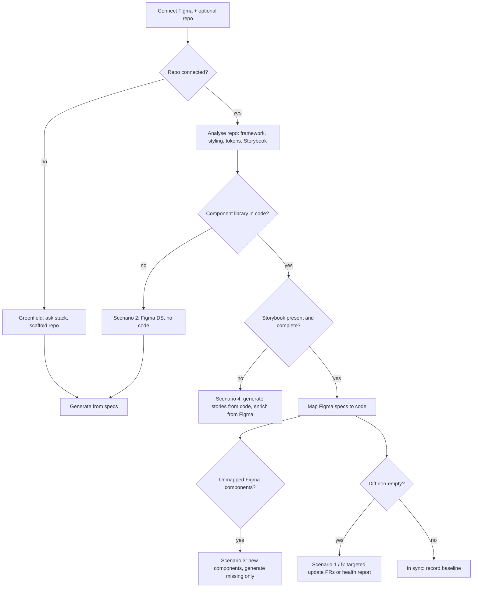
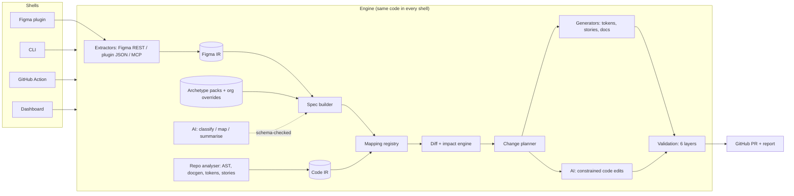
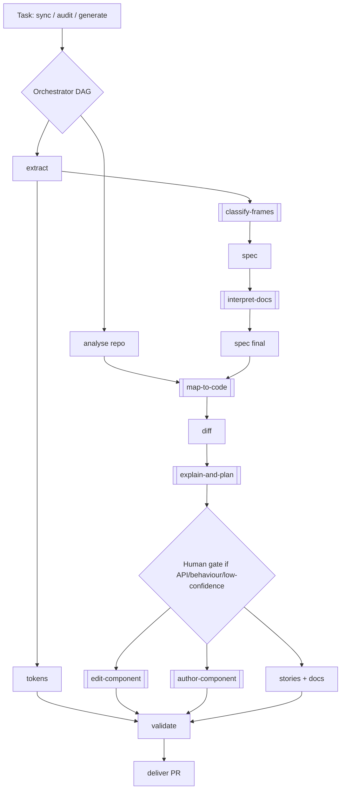
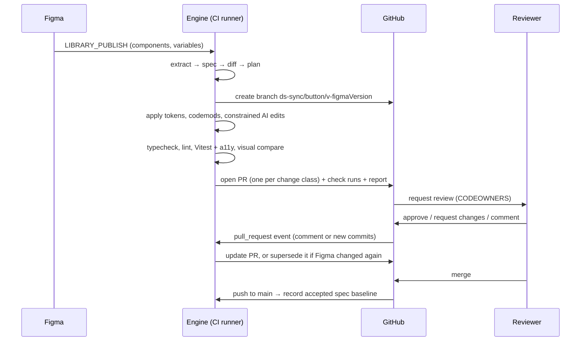
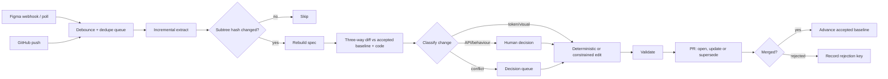
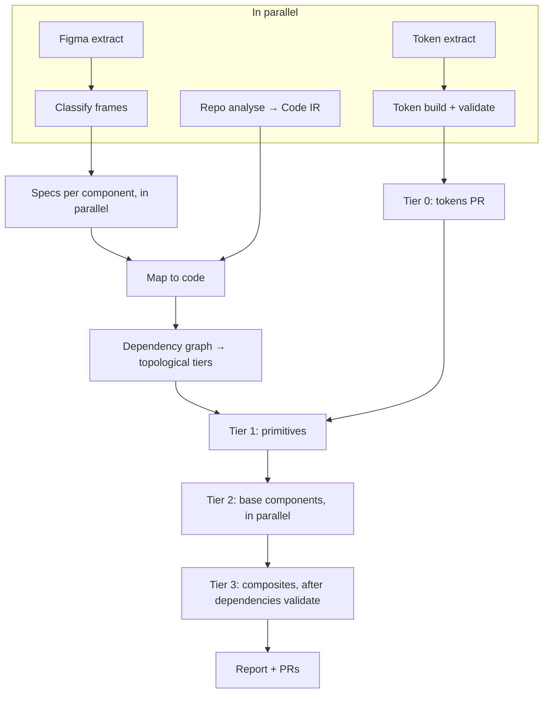
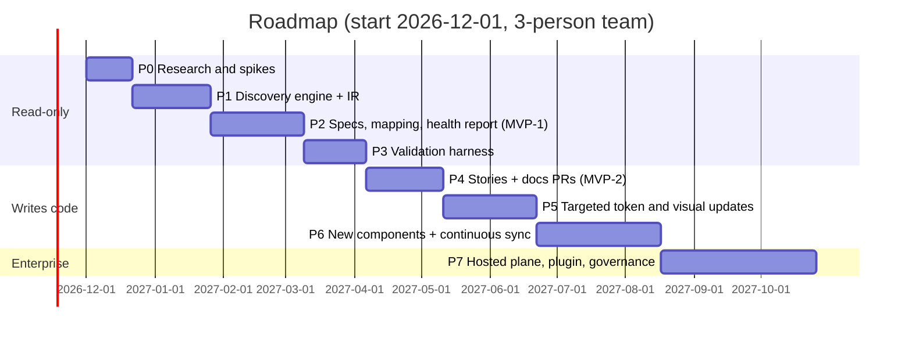
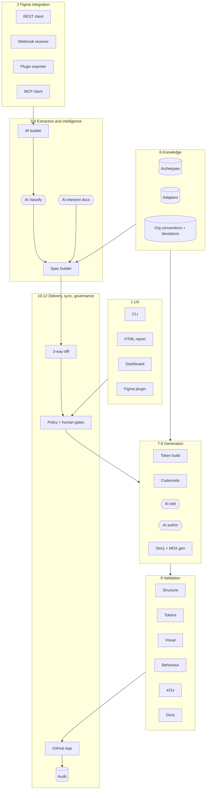
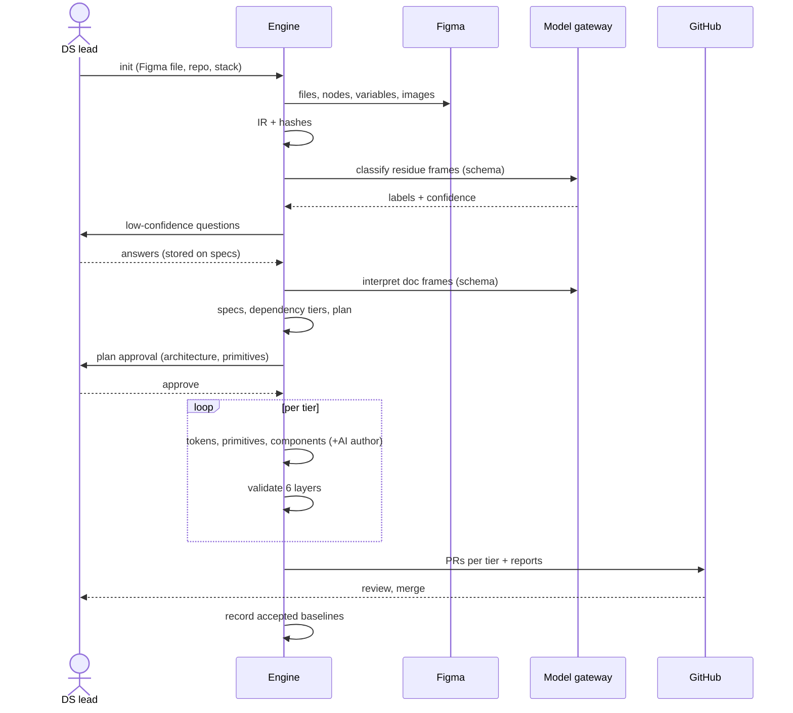
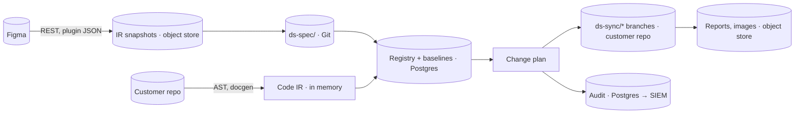

# Figma-to-Storybook AI — Technical Strategy

> **Note (Nov 13, 2026):** this is the original technical strategy, written before the build and exported from the working doc. Some recommendations changed during the build: the tool now generates a complete Storybook (React and Web Components) from Figma rather than only reporting drift on existing code. For how the system works today see [ARCHITECTURE.md](../ARCHITECTURE.md); for status and next steps see [PLAN.md](../PLAN.md).

Nov 12, 2026 · @Shivanshu Mathur

Build a spec-driven orchestration layer on top of Figma's APIs, Code Connect, DTCG and Style Dictionary, Storybook 10 and GitHub Apps. Make its core deterministic, and use AI only where interpretation is genuinely needed. Ship a read-only drift and health report first (about 14 weeks), then PR-based story, doc and targeted code updates. This is a product-discovery and architecture strategy, not an implementation; open questions and the working assumptions are at the end.

## 1. Executive summary

**Recommendation: build an orchestration layer, not a code generator.** Build a spec-driven design-system compiler that sits on top of existing infrastructure. Its core is a versioned component specification, a Figma-to-code mapping registry and a diff engine. AI is used only for interpretation and targeted code edits. Every change reaches code as a reviewed GitHub pull request.

**Problem.** Figma, code and Storybook drift apart because nothing connects them. Teams learn about drift from bugs, audits or design reviews, weeks after it happened.

**Opportunity.** Our research found no product that does the whole loop, from Figma to code to Storybook to GitHub to continuous sync (Chapter 3). The pieces do exist:

- Figma's REST API, Plugin API and MCP server expose component properties, variables and screenshots.
- Code Connect maps Figma components to code.
- Style Dictionary and the DTCG token format handle tokens.
- Storybook 10 runs render, interaction and accessibility tests through Vitest.
- GitHub Apps provide scoped, short-lived repository access.

The gap is the layer that joins them, decides what changed, and proves the result is correct.

**Proposed solution.** It runs in five stages:

1. Extract Figma deterministically into a normalized intermediate representation (IR).
2. Build a canonical Component Spec per component. AI classifies ambiguous frames and documentation, with confidence scores.
3. Map each spec to existing code through a registry, seeded from Code Connect where present.
4. Compute a structured diff between the spec and the code, then turn it into the smallest possible change set: tokens, styles, props, stories and docs.
5. Validate in six layers and open a PR with evidence attached.

**Core differentiator.** It is trustworthy, not just generative. Every generated line traces back to a Figma node, a spec field and a validation result. Behaviour Figma cannot express comes from tested headless primitives and archetype specifications, not from model guesses.

**Key architectural decisions.**

- Hybrid architecture (Approach D, Chapter 7) with a deterministic core.
- A Figma plugin later, not first. It is needed mainly where the Enterprise-only Variables REST API is unavailable, and for in-Figma designer feedback.
- Claude Skills package the AI steps, organised by task and archetype rather than by individual component.
- The first release ships a **read-only drift and health report** (Scenario 5) before writing any code. This builds trust and validates the IR at low risk.

**Realistic expectations.** Token, variant and story coverage can reach near-complete automation for well-structured Figma files. Behaviour, accessibility semantics and API design need human decisions. Visual fidelity can be measured and bounded, but 100% pixel parity is neither achievable nor a useful goal (Chapter 12).

**Evidence from your current prototype.** The folder `ds to storybook` holds 19 hand-written agent skills (one contract plus 18 per-component files). They prove the concept, and they also show three failure modes the platform must design out:

- per-component instruction files drift and contradict each other;
- prose snapshots cannot be diffed by machine;
- a strictly Figma-only scope hides real code APIs from developers.

Chapters 8 and 10 address each one.

## 2. Problem analysis

The root problem is that design and code have no shared, machine-readable contract. Without one, drift is invisible until a person notices it.

**Today's workflow.** A designer changes a component and publishes the library. Someone posts a note or files a ticket. A developer reads Dev Mode, edits the component, maybe updates the stories, and opens a PR. Reviewers judge the visual match by eye. Nothing records which Figma version the code matches.

**Major gaps.**

| Gap | What happens | Why tooling misses it |
| --- | --- | --- |
| No identity link | Nobody can say which code component implements a Figma component set. | Names differ (Dialog vs Modal, Input vs TextInput) and nothing stores the pairing. |
| No change signal | Designers publish, and engineering finds out later. | Figma webhooks exist but almost no team consumes them. |
| No structured diff | A version change is visible only as pixels. | Figma version history is not a semantic diff of props, tokens or anatomy. |
| Behaviour is unspecified | Figma shows the look, not the keyboard, focus or selection logic. | Static frames cannot carry interaction contracts. |
| Docs are written twice | Usage guidance lives in Figma frames and again in MDX. | No pipeline moves documentation between them. |
| Verification is manual | "Looks right" is the acceptance test. | Visual tests compare code to code, not code to design. |

**Stakeholders.**

| Stakeholder | Wants | Fears |
| --- | --- | --- |
| Design system designers | Changes reach code fast and faithfully. | A tool that forces them to restructure Figma. |
| Design system engineers | Small, reviewable PRs that follow their conventions. | AI rewriting working code, and noisy PRs. |
| Product engineers (consumers) | Accurate Storybook and a stable API. | Breaking changes without warning. |
| Accessibility specialists | Correct semantics and tested keyboard support. | Generated ARIA that looks right but is wrong. |
| Engineering leadership | Less duplicated work and a measurable design-system health score. | Vendor lock-in, security exposure, cost. |
| Security and compliance | Least privilege, auditability, data residency. | Source code and designs leaving the network. |

**Typical pain points (illustrative, not from interviews).**

- "I changed the padding three sprints ago, and it's still wrong in production."
- "Storybook shows props that don't exist anymore."
- "I don't know which Figma frame is the real spec and which is an example."
- "Every design review turns into a pixel argument."

**Business and engineering impact.** Drift costs rework, inconsistent UI, accessibility regressions and slower onboarding. The same component is often reimplemented when a team cannot find or trust the existing one. A measurable health score (Chapter 12) turns this into something leadership can track.

**Hidden requirements this analysis surfaces.**

1. **Identity before generation.** Mapping Figma components to code is a prerequisite, not a feature.
2. **Behaviour needs its own source.** Figma alone is insufficient; the system needs archetype contracts (for example, the WAI-ARIA patterns) and tested primitives.
3. **Some divergence is intentional.** Code may deliberately differ from Figma, through deprecated props, platform constraints or accessibility fixes. The system needs an explicit "accepted deviation" record, or it will reopen the same diff forever.
4. **Storybook has two audiences.** Designers want Figma parity; developers want the full API. Your current prototype hides code-only props, which serves the first audience and hurts the second (Chapter 10).

## 3. Existing market and technology research

**Finding: no product we could verify does the whole loop.** Each tool covers one or two stages, and none checks code against design. Everything below was checked on official pages on 2026-11-12. A claim marked *vendor claim* comes from marketing copy and is unverified; *not documented* means the page we opened did not say.

### 3.1 Figma's own platform

| Capability | What it gives us (verified) | Limits that shape the architecture |
| --- | --- | --- |
| [REST API: files and nodes](https://developers.figma.com/docs/rest-api/file-endpoints/) | Full node tree with `components` and `componentSets` maps, plus styles. Fetch by `ids`, `depth` and `version`; renders PNG or SVG up to 4x. | Tier 1 rate limits (10–20 requests per minute for Dev/Full seats). Image URLs expire after 30 days. |
| [REST API: variables](https://developers.figma.com/docs/rest-api/variables/) | Read and write variables, collections and modes. | **Enterprise plan only**, with a Full seat for writes. This is the single biggest constraint on token extraction. |
| [Webhooks](https://developers.figma.com/docs/rest-api/webhooks-events/) | `LIBRARY_PUBLISH` lists created, modified and deleted components, styles and variables. `FILE_UPDATE` fires after 30 minutes of inactivity. `FILE_VERSION_UPDATE` fires on named versions. `DEV_MODE_STATUS_UPDATE` fires on ready-for-dev changes. | 3 webhooks per file, 5 per folder, 20 per team. Retries at 5 min, 30 min and 3 h. Large publishes split into several events. |
| [Rate limits](https://developers.figma.com/docs/rest-api/rate-limits/) | Limits per seat, tier and plan, in force since 2025-11-17. | View/Collab seats get only 20 Tier 1 calls **per month**, so the service needs a Dev or Full seat identity. |
| [Plugin API](https://developers.figma.com/docs/plugins/api/figma-variables/) | Local variables, collections, library imports and node property access from inside the file. | Runs only while a user has the plugin open. Network is limited to allow-listed domains, and the iframe has a null origin. |
| [MCP server](https://developers.figma.com/docs/figma-mcp-server/tools-and-prompts) | `get_metadata`, `get_design_context`, `get_variable_defs`, `get_screenshot`, `search_design_system`, Code Connect tools, and `use_figma` for writes. | [200–600 calls per day](https://developers.figma.com/docs/figma-mcp-server/rate-limits-access/) depending on plan. Output is code-shaped (React + Tailwind by default) and is meant for agents, not as a deterministic data feed. |
| [Code Connect](https://developers.figma.com/docs/code-connect/) | Maps Figma components and properties to code snippets for React, HTML (including Vue and Angular), SwiftUI and Compose. Has a CLI and an in-Figma UI with GitHub access. | Shows snippets in Dev Mode and feeds MCP. **Validation of code against design is not documented.** Professional plans allow one framework at a time. |

### 3.2 Figma-to-code products

| Product | What it does (verified) | Storybook | GitHub | Sync | Main gap for us |
| --- | --- | --- | --- | --- | --- |
| [Builder.io Visual Copilot + component indexing](https://www.builder.io/c/docs/component-indexing) | Indexes a repo's components, tokens and icons with AI. Generates code from Figma that reuses mapped components. Manual `.mapper` files are [being replaced](https://builder.io/c/docs/cli-component-mapping-overview) by indexing. | Stories used only as context | `index-repo` and CI delta updates are Enterprise-only | One-way, Figma to code | States "typically \~70% mapping accuracy". Builds screens with your components rather than maintaining the components. |
| [Locofy Lightning](https://www.locofy.ai/docs/plugin/lightning/) | Figma or Penpot to React, Next, Vue, Angular, HTML, React Native and Flutter. Splits output into components with props. | Classic plugin can export story files; Lightning: not documented | Push to GitHub (Enterprise or legacy annual plans only) | One-way | A generator; no diff against existing code. |
| [Anima](https://www.animaapp.com/storybook) (Frontier, Design System Automation) | Frontier: VS Code tool that turns Figma into React using your existing components, after analysing the codebase locally. DSA: turns Storybook into a Figma library and keeps it synced. | Storybook to Figma | Not documented | Code to Figma (DSA); Figma to code (Frontier) | Opposite direction from our main need. Frontier targets screens, not library upkeep. |
| Quest AI | Directory listings describe Figma to React with GitHub deployment. | Not documented | Not documented | Not documented | **Unverified**: no official documentation could be opened. Status unclear. |

### 3.3 Tokens, docs and design-system platforms

| Product | What it does (verified) | Main gap for us |
| --- | --- | --- |
| [Tokens Studio](https://docs.tokens.studio/) | Token authoring in Figma; sync to GitHub, GitLab, Bitbucket and Azure DevOps; export to and import from Figma Variables; themes (Pro); DTCG or legacy format. | Tokens only. It is also a second source of truth when teams already use Figma Variables. |
| [Style Dictionary](https://styledictionary.com/info/dtcg/) | Transforms tokens to CSS, SCSS, JS, iOS and Android. First-class DTCG support since v4. | Full DTCG 2025.10 support is "a work in progress in v5". It is a build tool, not a sync tool. |
| [DTCG format](https://www.designtokens.org/tr/drafts/format/) | Standard token JSON (`$value`, `$type`, aliases, groups, `$extensions`). 2025.10 is the latest published version. | A community-group report, not a W3C Recommendation. Modes and themes are not in the core format. |
| [Supernova](https://www.supernova.io/developer-experience) | Token and asset pipelines into code with automatic PRs (GitHub, GitLab, Bitbucket, Azure). Hosts Storybook and syncs live stories into docs. Has a CLI and an SDK. | Component code generation is not documented. It does not diff components or check visual fidelity. |

### 3.4 Storybook ecosystem

| Capability | What it gives us (verified) |
| --- | --- |
| [Storybook 10 testing](https://storybook.js.org/docs/writing-tests) | Every story is a render test. Play functions give interaction tests. The a11y addon gives axe checks. All run through `@storybook/addon-vitest` (`vitest --project=storybook`); the test-runner is the non-Vite fallback. Coverage is optional. |
| [Storybook MCP and component manifest](https://storybook.js.org/docs/ai/mcp/overview) | Exposes a manifest of components, props, descriptions and examples to agents (React only, preview, off by default). |
| [Chromatic visual tests](https://www.chromatic.com/docs/figma) | Cross-browser snapshot baselines, code against code. The Figma plugin (Storybook Connect) links stories to Figma components and shows them side by side. **It does not diff Figma against stories.** |
| [story.to.design](https://divriots.com/blog/story-to-design-is-open) | Builds Figma components and variants from Storybook stories, the code-to-Figma direction. |

### 3.5 Agentic tooling

| Tool | Relevance |
| --- | --- |
| [Claude Agent Skills](https://platform.claude.com/docs/en/agents-and-tools/agent-skills/overview) | `SKILL.md` folders loaded by progressive disclosure: about 100 tokens of metadata always, the body when triggered, reference files and scripts on demand. Run in Claude Code (full network), the API (sandboxed, **no network**) and claude.ai. Not eligible for zero data retention. |
| Claude Code, Cursor, GitHub Copilot agents | Good at repository-aware edits inside a developer loop. None of them owns a Figma-to-code mapping or a validation contract. |
| LangGraph, OpenAI Agents SDK, custom state machines | Orchestration frameworks. The right choice depends on whether the steps are mostly deterministic (Chapter 7). Ours are. |

### 3.6 Unsolved gaps (our product's reason to exist)

1. **Library maintenance, not screen generation.** Builder, Locofy and Anima Frontier generate screens or new code. None maintains an existing component library through incremental, minimal PRs.
2. **Design-to-code verification.** Nothing verified checks rendered code against the Figma spec at the token, structure and visual levels. Chromatic compares code with code; Code Connect maps without validating.
3. **Semantic diffing.** Figma webhooks say *which* components changed, not *what* changed in their properties, tokens or anatomy.
4. **Behaviour contracts.** No tool supplies the interaction and accessibility spec that Figma lacks.
5. **Traceability and governance.** No tool keeps an auditable Figma node ↔ spec ↔ source file ↔ story ↔ test chain.

**Build, extend, combine or orchestrate?** Orchestrate. Reuse Figma's APIs and MCP for extraction, Code Connect as the identity registry, Style Dictionary for token output, Storybook and Vitest for tests, Chromatic or Playwright for snapshots, and a GitHub App for delivery. Build only the gap layer: IR, spec builder, mapping registry, diff and impact engine, validation-against-design, and governance. Extending Builder or Supernova would tie us to their roadmaps and still leave gaps 2–5 unsolved.

## 4. Use cases and scenarios

All scenarios reduce to one engine run with different starting evidence. The engine always builds the same artefacts (IR, specs, mapping, diff), and the scenario decides which outputs it is allowed to write.



### 4.1 The six given scenarios

| # | Scenario | Starting evidence | Engine output | Writes code? | Human gate |
| --- | --- | --- | --- | --- | --- |
| 1 | Existing Storybook + Figma; design changes | Figma change event, repo, mapping | Minimal diff PR: tokens, then styles, props, stories, docs | Yes, targeted | PR review; API changes need explicit approval |
| 2 | Figma DS, no Storybook or code | Figma only; stack from the user | New package: tokens, primitives first, then components, stories, docs | Yes, new files | Architecture plan approval before generation; PR per tier |
| 3 | Existing Storybook + new Figma components | Unmapped specs | "New vs extension" verdict, then code for the missing parts only | Yes, new files | Confirm the verdict when similarity is high |
| 4 | Code exists, Storybook incomplete | Repo only (Figma optional) | Stories, argTypes and docs from props and types; Figma enriches when present | Stories and docs only | Story PR review |
| 5 | All three exist but drifted | Figma, repo, Storybook | Health report: missing, extra, mismatched, deprecated | No (read-only) | None to run; triage to act |
| 6 | Many files, libraries, brands, repos | Several Figma files and repos | Federated inventory: which library owns which component, per-brand token sets | Per repo | Ownership mapping approval |

### 4.2 Workflow detail for Scenario 1 (the hardest one)

1. A `LIBRARY_PUBLISH` webhook arrives with `modified_components` and `modified_variables`.
2. Re-extract only those component sets and variable collections, at the new version.
3. Rebuild their specs and diff them against the last *accepted* spec, not the raw previous version.
4. Classify each change: token, visual style, structure (anatomy), API (props and variants), behaviour, or docs.
5. Find impacted code through the mapping registry and the dependency graph. A token change can touch 40 components; a Button anatomy change touches Button and its dependents.
6. Plan the edit. Token changes are deterministic transforms. Style changes go through a constrained AI edit with a diff budget. API changes need a human decision first.
7. Validate the touched components plus their dependents. Open one PR per change class, linked back to the Figma version.

**Preventing needless edits to working code.** This rests on three controls:

- *Diff scoping*: the planner may touch only files the mapping registry links to changed spec fields.
- *Change budget*: an edit outside the planned lines fails the plan check and is discarded.
- *Idempotence*: re-running on an unchanged spec must produce an empty diff. This is enforced in CI.

### 4.3 Additional scenarios we identified

| # | Scenario | Why it differs |
| --- | --- | --- |
| 7 | Code wraps a third-party library (MUI, Chakra, Ant, PrimeNG) | Figma maps to theme overrides and wrapper props, not to new components. Generating components would duplicate the vendor. |
| 8 | Rebrand or new theme only | The output is a new token mode or brand set. Component code should not change at all; a non-empty component diff is a red flag. |
| 9 | Framework migration (for example Angular to React) | The spec is the stable layer and code is regenerated per framework. This is the strongest argument for a framework-neutral IR. |
| 10 | Multi-platform (web, iOS, Android) | Tokens fan out through Style Dictionary. Components map per platform through Code Connect (SwiftUI, Compose). Storybook covers web only. |
| 11 | Deprecation and sunset | A component is removed from Figma but still used in code. The system must flag it and track usage, never delete it automatically. |
| 12 | Compliance audit (accessibility, brand) | Read-only reporting against WCAG and token rules, for regulated industries. |
| 13 | Figma built on a community kit | Many components are detached copies of a vendor kit. Identity has to come from structure, because names and keys are unreliable. |

## 5. Figma data extraction strategy

**Most structure is extractable deterministically. Intent is not.** Component sets, property definitions, auto layout, fills, strokes, effects and bound variables come straight from the APIs. Whether a frame is a spec or an example, which token is semantic, and how something behaves all need inference or a designer's answer.

### 5.1 Which source gives what

| Data | REST API | Plugin API | MCP server | Needs inference or a person |
| --- | --- | --- | --- | --- |
| Pages, sections, frames, groups | Yes (`depth`, `ids`) | Yes | `get_metadata` (XML outline) | — |
| Component sets, components, instances | Yes (`components`, `componentSets` maps; main component of each instance) | Yes | Yes | — |
| Variant axes and component properties (boolean, text, instance swap) | Yes, on component set nodes\* | Yes (`componentPropertyDefinitions`) | Via design context | Which axis is a *state* and which is a *variant* |
| Auto layout, padding, gap, sizing, constraints | Yes | Yes | Yes | Responsive intent beyond fill, hug and fixed |
| Fills, strokes, radius, effects, typography | Yes | Yes | Yes | — |
| Bound variables on nodes | Variable **ids** | Ids, names, values, modes | `get_variable_defs` (names and values for a selection) | — |
| Variable collections, modes, aliases | **Enterprise only** | Yes, on any plan (no restriction documented) | Partial (selection-scoped) | Semantic vs primitive role |
| Styles (legacy) | Yes | Yes | Yes | Whether style or variable is authoritative when both exist |
| Component descriptions, layer names, text | Yes | Yes | Yes | Meaning of documentation text |
| Dev Mode annotations, ready-for-dev status | Status via webhook | Annotations | Partly | — |
| Prototype interactions | Not verified | `reactions` | Not documented | Most behaviour (Chapter 9) |
| Renders for visual comparison | `GET /images` (up to 4x, 32 MP cap) | `exportAsync` | `get_screenshot` | — |
| Version history | Versions endpoint (Tier 2) | — | — | Semantic diff (computed by us) |

\* Based on the REST node type reference from memory; to be verified in Phase 0. The cells we opened are cited in Chapter 3.

**Extraction strategy.** It is layered by plan, with the same IR as output:

1. **Enterprise customers:** REST for nodes and variables, plus webhooks. Fully server-side and headless.
2. **Non-Enterprise customers:** REST for nodes, plus a small **extraction plugin** run by a designer that exports variables and collections as signed JSON to the service. The MCP server's `get_variable_defs` is a fallback for selection-sized reads.
3. **Air-gapped customers:** the plugin exports the full IR as a file, and a self-hosted runner ingests it (Chapter 14).

**Why not use MCP as the main pipe?** MCP returns agent-oriented, code-shaped context under per-day call caps (200–600 calls). It is excellent for an AI step that needs context on one node. It is the wrong choice for a deterministic, repeatable full-file extraction that must diff cleanly.

### 5.2 Answers to the critical questions

| # | Question | Answer | How |
| --- | --- | --- | --- |
| 1 | Complete structure of a component? | **Yes**, when it is a component set | Walk the set, its variants and nested instances |
| 2 | Definition vs example frame? | **Mostly.** Definitions are certain (`COMPONENT_SET` / `COMPONENT`); examples are frames of instances. Docs vs final-spec frames need classification. | Node type rules first, then an AI classifier with confidence (Chapter 6) |
| 3 | Actual variants? | **Yes** for sets. No for static frames posing as variants. | Property definitions; similarity clustering for static frames |
| 4 | Component relationships? | **Yes**, structurally | Nested-instance graph, instance-swap preferred values |
| 5 | All design variables? | **Yes** with Enterprise REST or the plugin; partial otherwise | Collections, modes, aliases |
| 6 | Semantic vs primitive tokens? | **Heuristically, then confirmed** | Alias depth (an alias to another variable is likely semantic), collection names, scopes, usage on nodes |
| 7 | Responsive behaviour? | **Partially** | Fill, hug and fixed sizing, min/max, constraints. Breakpoints are not native, so a designer supplies them |
| 8 | Interaction states? | **Visual states yes, transitions partially** | State-axis vocabulary (Hover, Pressed, Focus…), prototype reactions |
| 9 | Docs frame vs implementation reference? | **With confidence scores** | Names, text density, instance-vs-definition content, ready-for-dev status, designer confirmation |
| 10 | Missing or ambiguous information? | **Yes, as a first-class output** | The spec's `gaps[]`, computed against the archetype's required fields |

### 5.3 The intermediate representation (IR)

The pipeline has two layers, and code generation never reads raw Figma nodes:

- **Figma IR**: a lossless, normalized snapshot. It holds nodes keyed by stable `componentKey`, resolved variables per mode, and hashes per subtree. It is deterministic, cached and diffable.
- **Component Spec**: the meaning layer, organisation-independent and framework-neutral. It is built from the IR, the archetype and human decisions.

### 5.4 Canonical Component Spec (proposed v0)

Every field carries `source` (`figma` / `figma-doc` / `archetype` / `code` / `human`) and `confidence` (0–1). That is what makes the spec auditable.

```yaml
specVersion: 0.1
id: ds.button                    # stable, ours
name: Button
archetype: action.button          # Chapter 6
category: Actions                 # org taxonomy, configurable
status: stable | beta | deprecated
provenance:
  figma: { fileKey, nodeId, componentKey, versionId, page, publishedAt }
  irHash: sha256                  # of the normalized subtree
  code:  { repo, path, export: Button, codeConnectId? }
api:
  props:
    - name: variant
      type: enum[primary, secondary, ghost, danger]
      default: primary
      figmaProperty: Variant
      kind: visual | state | content | behaviour
      source: figma, confidence: 1.0
    - name: loading
      type: boolean
      source: code                # exists in code, not in Figma
      figmaCoverage: none         # documented as code-only, not hidden
variantMatrix:
  axes: [variant, size, radius]
  validCombinations: all | list   # sparse sets are explicit
  defaultVariant: { variant: primary, size: sm, radius: default }
states:
  - name: hover;    kind: interactive-pseudo; figmaVariant: State=Hover
  - name: disabled; kind: prop;               figmaVariant: State=Disabled
  - name: focused;  kind: interactive-pseudo; requires: focus-visible ring
anatomy:                          # named parts, each traceable to a node
  - part: root;          node: "102:122/Container"
  - part: leadingIcon;   slot: true; optional: true; figmaProperty: Has leading icon
  - part: label;         text: true
styles:                           # per part × variant × state, token refs only
  root.primary.default:
    background: { token: color.action.primary.bg, resolved: "#1F5EFF" }
    paddingInline: { token: space.4, resolved: 16px }
    radius: { token: radius.md }
tokens: [color.action.primary.bg, space.4, radius.md]
layout: { direction: row, gap: space.2, align: center, sizing: hug }
responsive: { rules: [], source: human?, gaps: [breakpoints] }
behaviour:
  pattern: wai-aria/button        # archetype default
  interactions: [activate-on-enter, activate-on-space]
  overrides: []                   # from figma-doc or human, cited
accessibility:
  role: button
  nameFrom: content | aria-label (icon-only)
  keyboard: [{ key: Enter, action: activate }, { key: Space, action: activate }]
  contrastFindings: [{ pair, ratio, mode, wcag: fail }]
assets: [{ name: icon/arrow-right, source: figma-component, componentKey }]
docs:                             # typed blocks lifted from doc frames
  - type: usage | do | dont | anatomy | content
    text: "…"; sourceNode: "1320:168"; confidence: 0.9
dependencies: [ds.icon, ds.spinner]
deviations:                       # accepted, intentional differences
  - field: api.props.size.options; note: "code keeps xs for legacy"; approvedBy; until
gaps:                             # what the archetype needs and nobody supplied
  - field: behaviour.loading; question: "Should loading block clicks?"
validation: { structural: pass, tokens: pass, visual: 0.96, functional: pass, a11y: fail[2] }
```

**Design rules for the spec.** It is schema-validated with JSON Schema. Each spec is one file per component in a `ds-spec/` folder in Git, so it can be reviewed and blamed. It is generated by default and editable by humans, and human edits are preserved through `source: human` precedence.

## 6. Component intelligence architecture

**Use about a dozen archetypes as data packs, not one skill per component.** An archetype carries what Figma cannot: required states, the behaviour contract, accessibility pattern, recommended headless primitive and story template. A component is classified into an archetype once. From then on its missing information is computable as "archetype requires it, nobody supplied it".

### 6.1 Archetype taxonomy

| Archetype | Examples from your list | Behaviour contract source | Typical primitive | Hard parts |
| --- | --- | --- | --- | --- |
| `action` | Button, Icon Button, Link Button, Tab Button | [WAI-ARIA APG](https://www.w3.org/WAI/ARIA/apg/patterns/) button / link | Native `<button>` / `<a>` | Icon-only names, loading semantics |
| `input.text` | Input, Rich Text Editor (composite) | Native input; APG for editors | Native, or a library for rich text | Validation timing, masking |
| `selection.binary` | Checkbox, Switch, Radio, Multi Switch | APG checkbox / switch / radio group | Native, or React Aria | Indeterminate, group roving focus |
| `selection.range` | Slider, Slider Rating, Rating | APG slider | React Aria / Radix | Keyboard step, RTL |
| `selection.list` | Dropdown Menu, Select, Paginator | APG combobox / listbox / menu | React Aria / Radix / Ark | Typeahead, virtualisation, multi-select |
| `navigation` | Breadcrumbs, Main Menu, Stepper, Pagination Dots, Anchor, Footer | APG breadcrumb / menubar / tabs | Native landmarks | Collapse and overflow, current-page semantics |
| `disclosure` | Accordion, Hierarchical Tree | APG accordion / treeview | React Aria / Radix | Single vs multiple expand, nesting |
| `overlay` | Modal, Side Panel, Popover, Tooltip | APG dialog / tooltip | Native `<dialog>`, Floating UI, React Aria | Focus trap, return focus, stacking, dismissal |
| `feedback` | Alert, Toast, Notification Card, Progress Bar, Spinner, LED, Status Indicator | ARIA live regions | Native + `role=status/alert` | Announcement politeness, timing |
| `data-display` | Badge, Tag, Avatar, Count Indicators, Divider, Lists, Code View | Mostly static | Native | Truncation, dot-only meaning |
| `data-grid` | Data Tables | APG grid / table | TanStack Table + React Aria | Sorting, selection, virtualisation |
| `input.file` | Drop Area / File Upload, Dragger | Native file input + drag events | react-dropzone-style primitive | Keyboard access to drop zones |
| `layout` | Scroll, Focus (as a foundation), Leader | n/a | CSS | Often not a component at all |

Organisations can add archetypes or override any field (Chapter 8).

### 6.2 Classification pipeline

1. **Structural rules (deterministic).** Component sets and components are definitions. Frames that contain instances are examples. Frames that are mostly text are documentation.
2. **Naming signals.** Page and frame names are matched against a multilingual vocabulary ("Anatomy", "Do's and Don'ts", "Specs", "Handoff"…), weighted rather than trusted.
3. **AI classification on the residue only.** A model sees the IR outline, text and a screenshot. It returns a schema-constrained label from a closed set: `definition | example | doc.usage | doc.anatomy | doc.a11y | doc.dodont | playground | deprecated | unknown`, with confidence and cited node ids.
4. **Designer confirmation** happens only for low-confidence labels, batched in one review screen.

**One component or several?** Variants of one component share an anatomy, differ along enumerable axes and are interchangeable in a layout slot. Evidence for a single component: same set, or static frames whose part trees are isomorphic. Evidence for separate ones: different anatomy (Icon Button has no label slot) or different semantics (Link Button navigates, Button acts). The engine proposes, and a person settles any proposal with confidence below 0.8.

### 6.3 Variants vs states vs props

| Figma axis value | Kind | Code expression | Story treatment |
| --- | --- | --- | --- |
| Primary / Secondary / Ghost | visual variant | enum prop | Matrix story |
| Sm / Md / Lg | size | enum prop | Side-by-side story |
| Disabled, Error, Selected | prop state | boolean or enum prop | Direct story |
| Hover, Pressed | pseudo state | CSS `:hover`, `:active` | Pseudo-states addon, or docs only |
| Focused | pseudo state | `:focus-visible` | Play function asserting focus |
| Loading, Empty, Skeleton | data state | prop | Direct story with fixture data |
| Expanded, Open | behavioural state | controlled or uncontrolled prop | Play function toggling it |

The classifier labels each axis value with one of these kinds. That single decision drives the API, the stories and the tests.

### 6.4 Explicit vs required-but-missing information

Each archetype declares `required` fields. For the Accordion example:

- **Figma can supply:** visual treatments, expanded and collapsed visuals, disabled, leading and trailing icon slots.
- **The archetype requires:** expand mode (single or multiple), heading level, keyboard map, collapse animation, and whether a single-mode panel can be fully closed.
- **Result:** each required field without a source becomes a `gap` with a concrete question. Generation proceeds with archetype defaults *marked as defaults*, and the PR lists them.

### 6.5 Dependencies

The dependency graph comes from nested instances, instance-swap preferred values and shared tokens. It decides build order: tokens, then primitives (Icon, Spinner, Focus ring), then simple components, then composites. Cycles are reported as design issues.

### 6.6 Confidence scoring

Per field, the score is the minimum of the source score and the agreement score:

- **Source score:** `figma` 1.0, `figma-doc` 0.85, `code` 0.9, `archetype default` 0.6, `AI inference` equal to the model's calibrated score.
- **Agreement score:** 1.0 if independent sources agree, reduced when they conflict.

Per component, the score is a weighted minimum over critical fields (identity, API, tokens, a11y), not an average, so one weak critical field cannot hide behind many strong ones. Thresholds: ≥ 0.9 automatic; 0.7–0.9 included and flagged in the PR; < 0.7 blocks until a person answers.

**Calibration.** Confidence numbers mean nothing until they are calibrated against human corrections. Phase 2 tracks predicted confidence against the observed correction rate and adjusts per source.

## 7. Architecture options

**Recommendation: Approach D (hybrid), delivered CI-first.** The MVP ships as a CLI plus a GitHub Action, with the same engine running in the customer's CI. The backend, dashboard and plugin follow once the engine has proven its accuracy. The engine is identical in every deployment; only the shell changes.

### 7.1 The options

- **A. Figma plugin.** Scans the open file, calls a backend, shows results. It works only while a user has it open, the network is allow-listed, and there is no background processing. Distribution goes through Figma Community or private org plugins. It is good for designer feedback and non-Enterprise variable extraction. It is bad as the system's core, because it cannot react to code changes or run unattended.
- **B. Agentic skills only.** Skills run inside Claude Code or another agent. This is fast to prototype (your current folder is exactly this). It is weak on repeatability, auditability and concurrency, and it needs a developer at a terminal. The prototype already shows the cost: 18 hand-kept skills that contradict each other within a week.
- **C. Backend orchestration platform.** A central service owns ingestion, specs, jobs and GitHub. It is scalable and governable, but expensive to build first, and source code must reach our servers. That is a blocker for regulated buyers.
- **D. Hybrid.** A deterministic core (extract, normalize, diff, validate) plus AI workers (classify, map, edit) behind schema contracts. The shells are CLI, GitHub Action, backend and plugin, all running the same engine.

### 7.2 Scored comparison (5 = best)

| Criterion | A Plugin | B Skills only | C Backend | D Hybrid |
| --- | --- | --- | --- | --- |
| Accuracy (repeatable, validated) | 2 | 2 | 4 | 5 |
| Scalability (files, repos, tenants) | 1 | 2 | 5 | 5 |
| Maintainability | 3 | 2 | 4 | 4 |
| Enterprise adoption | 3 | 2 | 3 | 5 |
| Development cost (5 = cheapest) | 4 | 5 | 2 | 3 |
| Complexity (5 = simplest) | 4 | 4 | 2 | 3 |
| Security (code stays in customer CI) | 3 | 4 | 2 | 5 |
| Extensibility (frameworks, archetypes) | 2 | 3 | 4 | 5 |
| Technology independence | 2 | 2 | 4 | 5 |
| Long-term ownership | 2 | 2 | 4 | 4 |
| **Total (of 50)** | **26** | **28** | **34** | **44** |

The scores are our judgement, not measurements. D wins mainly on accuracy, security and adoption. Its cost is reduced by building it CI-first.

### 7.3 Alternatives we considered

| Alternative | Verdict |
| --- | --- |
| E. CI-native only (CLI + GitHub Action, no backend) | **Adopt as the MVP shell.** Code never leaves the customer's runner, there is no tenancy to build, and PRs are native. The cost is no live dashboard; a static HTML report artifact fills that gap early on. |
| F. Build on Supernova or Builder.io | Reject as the core. It would tie the roadmap to theirs and still leave design-to-code verification and semantic diffing unsolved. Integrate as optional token or docs sinks. |
| G. Code Connect-centric (mappings as the only registry) | **Adopt partially.** Read and write Code Connect so Dev Mode and MCP benefit. Keep our own registry too, because Code Connect has no spec, diff or validation fields and is plan-limited. |
| H. Code-to-Figma first (Storybook as the source) | Reject as the primary direction, since it inverts the stated goal. story.to.design and Anima DSA already serve it. |

### 7.4 High-level architecture



Deterministic: everything except the two AI boxes. Both AI boxes produce schema-validated output that a deterministic step checks before it is used.

## 8. Agent and skills design

**Only two of the eleven proposed skills should stay purely AI. Five should be deterministic services, and four split into a service plus a small AI step.** Extraction, token transformation, diffing, story scaffolding, validation and GitHub delivery have exact right answers, and code gives them reproducibly. That leaves six AI skills, organised by task. Component knowledge lives in archetype packs and framework adapters, which are data the skills read.

### 8.1 Revised decomposition

| Proposed skill | Becomes | Why |
| --- | --- | --- |
| 1 Figma File Analyzer | **Service** `extract` + AI skill `classify-frames` (residue only) | Structure is exact. Only intent is fuzzy. |
| 2 Component Classifier | AI skill `classify-frames` (same skill) | One classifier, one label set |
| 3 Design Token Extractor | **Service** `tokens` (DTCG + Style Dictionary) | Deterministic transform. Semantic-role guesses are rules, then human confirmation. |
| 4 Spec Builder | **Service** `spec` + AI skill `interpret-docs` | Merging is code. Turning doc prose into typed blocks needs a model. |
| 5 Component Architect | AI skill `map-to-code` + **service** `graph` | Matching names and APIs across vocabularies needs judgement. Dependency order is a graph sort. |
| 6 Code Generator | AI skills `edit-component` and `author-component` | Edits to existing code and new code have different risks and budgets. |
| 7 Storybook Generator | **Service** `stories` (templates from spec), with AI for docs prose only | CSF from a spec is a template, and should be byte-stable. |
| 8 Visual Validation | **Service** `validate.visual` | Screenshots and metrics are code. AI may *explain* a diff but never pass it. |
| 9 Accessibility Validator | **Service** `validate.a11y` (axe + play tests) | Tool-based. Human for judgement calls. |
| 10 GitHub Integration | **Service** `deliver` | Least privilege needs code paths that can be audited. |
| 11 Design-Code Sync | **Service** `diff` + AI skill `explain-and-plan` | Diffs are exact. Planning API-breaking changes and writing the rationale needs a model. |

**Final AI skill set (six):** `classify-frames`, `interpret-docs`, `map-to-code`, `edit-component`, `author-component`, `explain-and-plan`.

### 8.2 Component knowledge model

Per-component Markdown references (`button.md`, `accordion.md`…) are the pattern your prototype uses, and they are what drifted. Knowledge is instead split by what varies:

```text
knowledge/
  archetypes/
    disclosure/
      archetype.yaml        # required fields, states, keyboard map, a11y pattern, defaults
      behaviour.contract.ts # executable assertions (play-function library)
      story.template.ts     # CSF template parameterised by the spec
      fixtures/             # sample specs + expected outputs (golden tests)
      GUIDE.md              # prose for AI skills: pitfalls, edge cases (short)
  adapters/
    react-css-modules/      # idioms, file layout, templates, lint rules
    vue-sfc/  angular-standalone/  web-components-lit/
  org/                      # per customer, in their repo
    conventions.yaml        # naming, folder layout, story taxonomy, prop naming map
    overrides/disclosure.yaml
    deviations.yaml         # accepted design-code differences
```

**Precedence:** human decision on the spec, then org override, then design-system default, then archetype, then global default. Every resolved value records the layer it came from, so a reviewer can see why it was chosen.

**Why this beats per-component files.** About 12 archetypes × 4 adapters replace hundreds of hand-written references. Golden fixtures test the knowledge itself in CI: a change to the disclosure archetype re-runs its fixtures, so contradictions like the ones found in your prototype fail a build instead of reaching a run.

### 8.3 Input and output contracts

| Step | Input | Output (JSON Schema) | Deterministic check before use |
| --- | --- | --- | --- |
| `classify-frames` | IR outline, text, screenshot of one frame | `{label, confidence, evidenceNodeIds[]}` | Label in a closed enum; evidence ids exist in the IR |
| `interpret-docs` | Doc-frame text + archetype fields | `docs[]` blocks, `behaviourHints[]` with quotes | Each block quotes source text verbatim (substring check) |
| `map-to-code` | Spec + Code IR candidates | `{codeExport, propMap{}, confidence}` | Every mapped prop exists in the Code IR; types are compatible |
| `edit-component` | Spec diff, file contents, adapter, budget | Unified diff + rationale per hunk | Applies cleanly; touches only planned files and regions; lint, typecheck and tests pass |
| `author-component` | Spec, archetype, adapter, primitive | File set | Archetype contract tests pass; no raw values where tokens exist |
| `explain-and-plan` | Diff set, deviations, API impact | Change plan + PR text | Plan covers every diff item exactly once |

All model calls use structured outputs against these schemas. Output that fails a schema is retried once with the validation error, then escalated to a person. It is never silently accepted.

### 8.4 Orchestration and skill selection

The orchestrator is a deterministic workflow, not an agent choosing its next tool. It runs a DAG (Chapter 15 has the execution order). It selects knowledge by rule: `archetype` picks the pack, the repo analysis picks the adapter, and the task picks the skill. Models never choose which skill runs.



Double-bordered boxes are AI skills. Everything else is deterministic.

### 8.5 Error handling

- **Isolation:** each component is its own unit of work. One failure never aborts the batch; it is reported and the rest proceed.
- **Checkpoints:** every step persists its output under a content hash. A rerun resumes from the last valid step, and identical input skips work entirely, which also caps model cost.
- **Bounded retries:** API errors back off using `Retry-After`. AI schema failures retry once, then escalate.
- **Loop guards:** a maximum tool-call count per skill run, and no unbounded agent loops.
- **Honest failure:** a step that cannot meet its contract emits a `gap` or `blocked` item. It never emits plausible output.

### 8.6 Should we use Claude Skills?

**Yes, as packaging for the six AI skills in developer-run mode (Claude Code, CLI).** Progressive disclosure fits the knowledge model: the skill body stays small, archetype files load on demand, and validators ship as scripts whose code never enters context. Three caveats:

- API-hosted Skills run in a sandbox with **no network access**.
- Skills are **not eligible for zero data retention**.
- Custom Skills do not sync across surfaces.

For the server-side engine, call models directly with structured outputs and keep the same knowledge files. That keeps the platform model-agnostic for customers who mandate a private or approved model (Chapter 14).

## 9. Code generation strategy

**Generate less code, and lean on tested primitives.** Most production risk lives in interaction logic, and the visual layer is comparatively safe. So:

- generate the visual layer (tokens and styles) deterministically;
- wrap proven headless primitives for behaviour;
- use AI to write only the glue, inside a tight change budget.

### 9.1 What "production-ready" means: measurable gates

A generated or edited component is production-ready only when every gate passes, or an approved deviation covers it.

| Area | Gate | How it is measured |
| --- | --- | --- |
| API | Prop names and types follow `conventions.yaml`; no breaking change without approval | API extractor diff (TypeScript declarations); semver label on the PR |
| Types | `tsc --noEmit` clean; no `any` in public types | Typecheck in CI |
| Tokens | 0 raw colour, space, radius or shadow values where a token exists | Stylelint rule + a token-reference scanner |
| Visual | Structural and token layers pass; perceptual score ≥ threshold per variant (Chapter 12) | Validation report |
| Behaviour | Every archetype contract assertion passes | Play-function library run through Vitest |
| Accessibility | 0 axe violations at `error`; keyboard map tested; name, role and value checked | a11y addon with `test: 'error'` + contract tests |
| Tests | Every variant renders; every behaviour has a play test | Story count ≥ spec story plan |
| Quality | Lint clean; no new dependencies outside the allow-list | ESLint; dependency diff |
| Size | Bundle delta under budget per component | size-limit or equivalent |
| Docs | Every public prop has a description; every story has a source citation | Docgen coverage |
| Tree shaking | Side-effect-free module; named exports | Bundler analysis |

### 9.2 Framework support

The spec is framework-neutral, and **adapters** turn it into code. Each adapter owns templates, file layout, idioms, lint config and a primitive library:

| Adapter | Behaviour primitives | Styling default | Phase |
| --- | --- | --- | --- |
| React + TypeScript | [React Aria](https://react-spectrum.adobe.com/react-aria/) or [Radix](https://www.radix-ui.com/primitives) (match what the repo uses) | CSS Modules + CSS variables; Tailwind / CSS-in-JS when detected | MVP |
| Vue 3 | Ark UI / Reka-style headless libraries | SFC scoped CSS + variables | Later |
| Angular | Angular CDK | Component styles + variables | Later |
| Web Components | Lit + native elements | Shadow DOM + CSS variables | Later |

The adapter is **inferred from the repo** (Chapter 16) and never assumed. Primitive choice is library names only here; versions are pinned per customer at setup.

### 9.3 Component architecture

Build order follows the dependency graph:

1. **Tokens:** DTCG JSON transformed by Style Dictionary into CSS custom properties, with one mode per theme or brand.
2. **Primitives:** Icon, Spinner, Focus ring, VisuallyHidden, Slot / Polymorphic.
3. **Base components:** Button, Badge, Checkbox…, each a thin styled wrapper around a native element or headless primitive.
4. **Composites:** Dropdown, Dialog, Date Picker, Data Table, which compose base components.

**Sharing is decided by the graph, not by the model.** Button, Icon Button and Link Button share a `ButtonBase` when their specs share anatomy and tokens. The architect step proposes this with evidence, and a person approves new shared primitives.

### 9.4 Design token implementation

- **Three tiers:** primitive (`blue.500`), semantic (`color.action.primary.bg`) and component (`button.primary.bg`, optional). Components reference semantic or component tokens only.
- Figma modes become CSS variable scopes (`[data-theme=dark]`, `[data-brand=b]`).
- Unresolvable values (a raw hex in Figma with no variable) become a **token gap**. They are reported to design rather than hardcoded silently.

### 9.5 Handling behaviour that Figma does not define

This is the core anti-hallucination rule. **Behaviour comes from three sources only:**

1. the archetype contract (for example the WAI-ARIA pattern);
2. a cited sentence in a Figma doc frame;
3. a human decision recorded on the spec.

Anything else is a `gap`. For a Dropdown that means:

- keyboard, typeahead, Escape, outside click and focus return come from the primitive and the contract;
- multi-select, search and async loading are generated only if the spec has them from source 2 or 3;
- otherwise they are listed in the PR as open questions, and no code is written for them.

### 9.6 Editing existing code vs authoring new code

|  | `edit-component` | `author-component` |
| --- | --- | --- |
| Input | Spec diff + current files | Full spec + archetype + adapter |
| Budget | Only planned files and regions; maximum changed lines per diff item | New files only, in planned paths |
| Style | Must match existing code: same patterns, naming, imports | Adapter templates + org conventions |
| Rejection | Any hunk outside the plan; a test that previously passed now fails | Any contract or gate failure |

**Prefer deterministic codemods where possible.** Renaming a token reference or adding an enum value to a union type should use an AST transform, not a model. The model is reserved for changes that need judgement.

## 10. Storybook architecture

**Storybook is generated from the spec, documents the full code API, and marks Figma coverage instead of hiding code-only features.** It serves both audiences: designers see parity with Figma, and developers see everything they can actually use.

### 10.1 Where documentation comes from

The source is chosen field by field, from neither Figma alone nor code alone:

| Docs content | Authoritative source | Why |
| --- | --- | --- |
| Description, usage, when to use, do's and don'ts, content guidance | Figma doc frames (via `interpret-docs`, verbatim quotes) | Designers own guidance |
| Anatomy | Spec anatomy (Figma node tree) | Structural fact |
| Props table: names, types, defaults | Code (docgen / TypeScript) | Code is what consumers call |
| Prop descriptions | Code JSDoc; falls back to the Figma property description | Engineers own the API |
| Figma coverage per prop | Mapping registry | Shows parity honestly |
| Variants and states | Spec matrix | Shared |
| Keyboard and accessibility | Archetype contract + passing tests | Only claims that are tested |
| Design references | Figma node links + version | Traceability |

**Changing your prototype's rule.** Your current agent hides code-only props such as `loading` and `fullWidth`. The platform instead shows them in a **"Code-only" group** with a coverage badge and an optional design ticket. Hiding real API makes Storybook untrustworthy for developers, which defeats its main job.

### 10.2 Story plan (derived from the spec)

| Story | Generated when | Contents |
| --- | --- | --- |
| `Default` | Always | Figma default variant, all props at defaults |
| `<AxisA>And<AxisB>` matrix | A Figma grid documents two axes | Layout mirrors the Figma grid |
| `<Axis>` | Each remaining axis | Side by side |
| `With<Part>` | Each boolean or instance-swap that changes anatomy | Part on and off |
| `<Behaviour>` (play) | Each archetype contract item | Interaction + assertions |
| `Keyboard` (play) | Archetype has a keyboard map | Every row asserted |
| `States` | Prop and data states | Disabled, Error, Loading… |
| `CodeOnly/<Feature>` | Code-only props | Marked in a docs callout |
| `DoDont` | Figma has do/don't pairs | Docs-only (`tags: ['!dev']`) |

Pseudo states (hover, pressed) use `storybook-addon-pseudo-states` when the org opts in once in `conventions.yaml`, rather than being asked on every run.

### 10.3 Controls and argTypes

- `args` defaults equal Figma defaults where Figma covers the prop, otherwise code defaults.
- `argTypes` options are restricted to valid values, and invalid combinations from a sparse variant matrix are disabled through conditional `if` argTypes.
- Each argType description cites its source: `Figma: Variant` or `Code-only`.

### 10.4 Organisation

The taxonomy is configurable in `conventions.yaml`. The default is `Foundations / Components / {category} / {name}`, plus `Patterns` and `Templates`. Categories come from the archetype unless the org maps them. Titles use the Figma name; when it differs from the code export (Dialog vs `Modal`), the docs page states both.

### 10.5 Generated vs hand-written stories

The two are kept apart physically so regeneration never destroys human work:

- `Button.stories.tsx` is generated. It carries a header with the spec hash, and it is overwritten on regeneration.
- `Button.recipes.stories.tsx` is hand-written, titled `Components/Button/Recipes`, and never touched by the engine.
- In MDX, generated sections sit between markers; text outside the markers is preserved.
- CI fails if a generated file was edited by hand (hash mismatch), and tells the author to move the change to recipes or the spec.

### 10.6 Testing inside Storybook

- `@storybook/addon-vitest` runs render, play and a11y tests (`vitest --project=storybook`) in CI.
- The a11y addon runs with `test: 'error'`. Known design-caused contrast failures are tracked as deviations with an expiry date, instead of stalling every run (a problem your prototype hit).
- Visual regression (code against code) uses Chromatic or Playwright snapshots. Fidelity to Figma is a separate layer (Chapter 12).

### 10.7 Scale and composition

- **Multiple repos and libraries:** Storybook Composition (`refs`) joins per-package Storybooks into one portal.
- **Agents as consumers:** enabling the [Storybook component manifest and MCP](https://storybook.js.org/docs/ai/mcp/overview) (React, preview) lets product teams' coding agents find the right component. Our generated docs make that manifest richer.

### 10.8 Maintenance

Regeneration is idempotent: same spec, byte-identical output, with stable ordering and formatting. A story diff in a PR therefore always means a real spec change.

## 11. GitHub integration

**Use a GitHub App, installed per organisation on selected repositories, and deliver everything as pull requests.** The engine never pushes to protected branches. It merges nothing unless the customer's own branch rules allow it.

### 11.1 Authentication: GitHub App vs tokens

| Option | Verdict | Reason ([GitHub docs](https://docs.github.com/en/apps/creating-github-apps/about-creating-github-apps/deciding-when-to-build-a-github-app)) |
| --- | --- | --- |
| **GitHub App** | **Recommended** | Fine-grained permissions; short-lived installation tokens; not tied to a person who may leave; rate limits scale with the org; the installer picks the repositories. Also available on GitHub Enterprise Server. |
| Fine-grained PAT | Local CLI use only | Tied to one person; easy to over-scope. |
| Classic PAT / OAuth app | Reject | Broad scopes, long-lived tokens, access to every repo the user can see. |

### 11.2 Least-privilege permissions

| Permission | Level | Why |
| --- | --- | --- |
| Metadata | Read | Required baseline |
| Contents | Read & write | Read code; push to `ds-sync/*` branches only (enforced by branch rulesets) |
| Pull requests | Read & write | Open, update and comment on PRs |
| Checks | Read & write | Publish validation as check runs with annotations |
| Workflows | **Not requested** | The engine must never edit CI definitions |
| Administration, secrets, members | **Not requested** | Not needed |

Webhooks to subscribe: `push` (default branch), `pull_request`, `check_suite`.

### 11.3 Repository analysis (inferred, not asked)

The analyser reads `package.json` and lockfiles, workspace config (pnpm, Nx, Turborepo), `tsconfig`, `.storybook/main.*`, lint and format configs, styling dependencies, token files and existing stories. From these it builds the **Code IR**: exported components, prop types (via TypeScript AST or react-docgen), imports, style files, token references, story files and test files. It also finds near-duplicate components (similar names and prop shapes) for the duplicate-implementation report.

### 11.4 Pull request workflow



**PR conventions.**

- Branch name: `ds-sync/<component|tokens>/<figma-version>`.
- Commit trailers: `Figma-Node:`, `Figma-Version:`, `Spec-Hash:`, `Change-Class:`.
- The PR body holds the change table (spec field, old → new, files touched), the validation summary, before/after images, gaps and questions, and a link to the Figma node.
- **One PR per change class** (tokens / visual / API / stories-docs), so a reviewer can approve the safe ones quickly.
- Labels: `ds-sync`, `semver:patch|minor|major`, `needs-design-decision`.

### 11.5 Safety controls

| Risk | Control |
| --- | --- |
| Blind overwrite | Only planned files and regions may change; any other hunk fails the plan check |
| Unrelated components | The impact set comes from the mapping registry + dependency graph; files outside it are read-only |
| Breaking API changes | API extractor diff → `semver:major` label + required human approval; a deprecation path is proposed (keep the old prop, warn) |
| Repeated identical PRs | Idempotency key = hash(spec diff + base commit). An open PR with the same key is updated, not duplicated. A rejected key is remembered until the spec changes again. |
| Merge conflicts | Rebase automatically; a conflict inside a planned region triggers a re-plan from the new base; still conflicted → hand to a person with an explanation |
| Concurrent design + code edits | Three-way diff: last accepted spec, new Figma spec, current code (Chapter 13) |
| Rollback | Every PR is revertable as a unit (`git revert`); the accepted-spec baseline moves only on merge, so a revert re-opens the diff truthfully |
| Convention drift | The adapter plus `conventions.yaml` are applied, and lint and format run before commit |

### 11.6 CI/CD

- **MVP:** a GitHub Action runs the engine in the customer's runner, triggered by a scheduled poll, `repository_dispatch` from a webhook relay, or manually.
- **Later:** the hosted service receives Figma webhooks and dispatches to the customer's runner, so code still never leaves their infrastructure.
- **Release:** the customer's existing release flow is used (Changesets or semantic-release). The engine only adds changeset files.

GitLab, Bitbucket and Azure DevOps come later, behind the same `deliver` interface.

## 12. Validation and accuracy framework

**Gate on facts that can be measured exactly. Use pixels as evidence, not as the verdict.** Geometry and computed styles can be compared with the spec almost deterministically. Whole-image pixel diffs between Figma and a browser are noisy by nature, so they are reported and thresholded but never sufficient on their own.

### 12.1 The six layers

| Layer | Checks | Method | Blocking? |
| --- | --- | --- | --- |
| 1 Structural | Component exists; props and variants match the spec; anatomy parts present; dependencies resolved | Spec vs Code IR (AST) and rendered DOM (`data-part` attributes) | Yes |
| 2 Tokens | Every styled property references the right token; no raw values; modes resolve | Static scan + `getComputedStyle` per part, variant and state vs resolved spec values | Yes |
| 3 Visual | Layout and appearance match Figma | Three-tier comparison (12.2) | Tiers a and b yes; tier c flags |
| 4 Functional | Archetype behaviour contract, keyboard map, focus management, states | Play functions via `@storybook/addon-vitest` | Yes |
| 5 Accessibility | axe rules, names, roles, contrast | a11y addon `test: 'error'` + contract tests | Yes, unless an approved, expiring deviation exists |
| 6 Documentation | Every spec variant has a story; every prop documented; citations resolve; deprecated items marked | Spec ↔ story plan ↔ docgen coverage | Yes for coverage; prose is reviewed |

### 12.2 Visual comparison method

**Reference.** Render each Figma variant through `GET /v1/images` at 2x PNG, pinned to the spec's `versionId`, with text from the spec.

**Candidate.** Render the matching story args in Playwright Chromium at DPR 2. Use the same font files (self-hosted), animations off, a fixed viewport, and the same text content.

**Comparison, in three tiers:**

- **a. Geometry.** Each anatomy part's box relative to the root, compared with Figma's node bounds. Tolerance ±1 px, configurable.
- **b. Computed style.** Colour (exact after colour-space normalisation), radius, border, padding and gap (±0.5 px), font family, weight and size (exact), line height (±1 px).
- **c. Perceptual.** An SSIM or anti-aliasing-tolerant pixel diff on the whole variant, giving a 0–1 score with a heatmap attached to the PR.

**Why pixel diffs alone mislead.** Figma and browsers rasterise text differently: hinting, sub-pixel anti-aliasing, and a different line-height and baseline model. Shadows and blurs are also rendered differently. Dynamic content and font fallback add more noise. A pure pixel threshold therefore produces false failures on correct code and can pass wrong code that happens to be visually close. Tiers a and b catch real defects; tier c catches the rest and is reviewed by people.

**Code against code.** Regression after merge uses Chromatic or Playwright snapshots against the previous baseline, which is a separate and well-solved problem.

### 12.3 KPIs (reported separately, never blended)

| KPI | Formula | Target (initial, to calibrate) |
| --- | --- | --- |
| Component extraction coverage | components in IR ÷ components a designer confirms exist | ≥ 98% |
| False component rate | non-components labelled as components ÷ labelled components | ≤ 2% |
| Variant extraction coverage | variant combinations in spec ÷ valid combinations in Figma | 100% for component sets |
| Token mapping accuracy | style properties with the correct token ÷ style properties checked | ≥ 99% |
| Hardcoded value rate | raw values where a token exists ÷ styled properties | ≤ 1% |
| Structural pass rate | components passing layer 1 ÷ components processed | ≥ 95% |
| Visual similarity | median and p10 of the tier c score per component | Median ≥ 0.97, p10 ≥ 0.92 |
| Geometry and style pass rate | variants passing tiers a and b ÷ variants | ≥ 95% |
| Functional test pass rate | passing contract assertions ÷ assertions | 100% before merge |
| Story coverage | spec variants and behaviours with a story ÷ spec items | 100% |
| Documentation coverage | documented public props ÷ public props | ≥ 95% |
| Manual correction rate | lines changed by reviewers after generation ÷ lines generated | ≤ 10% (the key trust metric) |
| PR acceptance rate | merged generated PRs ÷ opened | ≥ 80% |
| Drift detection precision and recall | true drift found ÷ reported; true drift found ÷ all true drift (seeded test set) | Both ≥ 95% |
| Mean time from Figma publish to merged PR | median hours | < 48 h (organisational) |

KPIs are computed per component and per archetype, and shown as distributions. Low-confidence and design-gap items are reported separately so they do not inflate the scores.

### 12.4 Human approval: when and who

| Trigger | Approver | Where |
| --- | --- | --- |
| Ambiguous design (component < 0.7 confidence) | Design system designer | Dashboard review queue or plugin |
| Missing behaviour specification | DS engineer + designer | PR question, or spec edit |
| Breaking API change | DS engineer (CODEOWNER) | PR, with `semver:major` |
| New shared primitive or architecture change | DS tech lead | Plan approval before generation |
| Visual mismatch above threshold | Designer | PR images; accept as a deviation or fix |
| Accessibility trade-off or deviation | Accessibility owner | PR + `deviations.yaml` entry with an expiry date |
| First run on a new repo | DS tech lead | Mapping report approval |

## 13. Synchronization strategy

**One authoritative source per attribute, a three-way diff, and no automatic writes back to Figma.** True bidirectional sync of components is not realistic or desirable. What is realistic is design-led sync for visual attributes, code-led ownership of API and behaviour, and code-to-Figma *signals* (comments, status, Code Connect).

### 13.1 Change detection

| Trigger | Use | Caveat |
| --- | --- | --- |
| Figma `LIBRARY_PUBLISH` webhook | **Primary.** Names the created, modified and deleted components, styles and variables. | One publish may arrive as several events; debounce per file for about 2 minutes |
| Figma `FILE_VERSION_UPDATE` | Named versions as explicit sync points | Depends on designers naming versions |
| Figma `FILE_UPDATE` | Draft-change previews (optional) | Fires after 30 minutes idle; noisy |
| Polling the versions endpoint | Fallback when webhooks are not allowed | Tier 2 rate limits; hourly is enough |
| GitHub `push` to the default branch | Code-side drift (a developer changed a mapped component) | Diff against the accepted spec |
| Scheduled full audit | Weekly health report; catches missed events | Uses the cache, so it is cheap |

**Incremental extraction.** Only the component sets and variable collections named by the event are re-read. Each IR subtree carries a hash, so an unchanged hash means no spec rebuild. A variable change fans out to every component whose spec references it, through the token index.

### 13.2 Source of truth by attribute

| Attribute | Authority | The other side's role |
| --- | --- | --- |
| Token values, modes and themes | Figma variables (or Tokens Studio, if that is the org's chosen tool, but never both) | Code consumes generated output |
| Visual style: spacing, radius, colour, typography, effects | Figma | Code deviations need an approved record |
| Variant set (which visual options exist) | Figma | Code may have extra options, documented as code-only |
| Anatomy (which parts exist) | Figma | A new part in code is flagged for design |
| Prop names, types, defaults (API) | **Code** | Figma property names map through the registry |
| Behaviour, keyboard, focus | **Archetype + code** | Figma doc text is input, not authority |
| Accessibility semantics | **Code + accessibility owner** | Figma annotations are input |
| Usage guidance, do/don't | Figma docs | Mirrored into MDX |
| Story and doc layout | Generated from the spec | Hand-written recipes kept separately |

### 13.3 The Day 1–13 example

| Day | Event | System response |
| --- | --- | --- |
| 1 | Button created in Figma | Inventory lists it as unmapped |
| 2 | Generation | PR #1 merged; the accepted spec baseline S1 is recorded |
| 10 | Padding changed | Visual-class diff (`space.3` → `space.4`); deterministic token edit; PR #2, auto-approvable by policy |
| 11 | New variant "Tertiary" | API-class diff (enum gains a value, which is minor semver); constrained AI edit + new stories; PR #3 needs review |
| 12 | Developer edits Button on their own | Push event; code diverges from S1 |
| 13 | Detection | Three-way diff (below); conflicting fields become a decision item |

**Three-way diff.** Let base = the accepted spec S1, design = the new Figma spec, and code = the spec re-derived from the current code. For each field:

- base = code, and design changed: design-led update.
- base = design, and code changed: code-led change. For a visual field it becomes a deviation request, or a "push to Figma" suggestion. For an API field it is accepted, and the mapping is updated.
- both changed, to the same value: no-op, and the baseline is advanced.
- both changed, to different values: **conflict**. No automatic resolution; it goes to the decision queue with both sides shown.

### 13.4 Impact classification

| Change | Token update | CSS | API | New stories | Docs | Functional | Human approval |
| --- | --- | --- | --- | --- | --- | --- | --- |
| Variable value | ✓ | — | — | — | — | — | Policy (often automatic) |
| Style bound to a different token | — | ✓ | — | — | — | — | Review |
| Raw value change (no token) | Gap | ✓ | — | — | — | — | Review + token gap |
| New variant option | — | ✓ | ✓ (minor) | ✓ | ✓ | Maybe | Review |
| Removed variant option | — | ✓ | ✓ (major) | ✓ | ✓ | — | **Required** |
| New boolean or slot | — | ✓ | ✓ | ✓ | ✓ | Maybe | Review |
| Anatomy restructure | — | ✓ | Maybe | ✓ | ✓ | Maybe | **Required** |
| Doc text change | — | — | — | — | ✓ | — | Auto or light review |
| Behaviour doc change | — | — | Maybe | ✓ | ✓ | ✓ | **Required** |

### 13.5 Bidirectional feasibility

| Direction | What can flow safely | Mechanism |
| --- | --- | --- |
| Figma → code | Tokens, styles, variants, anatomy, docs | PRs |
| Code → Figma | **Signals only:** Code Connect mappings, Dev Mode comments ("code has prop X"), a drift status per component | Code Connect publish, REST comments |
| Code → Figma (writing components) | **Not recommended.** MCP `use_figma` and story.to.design make it possible, but generated Figma components overwrite designer intent and break library consumers. | Optional, per explicit request, into a separate branch file |

### 13.6 Sync workflow



## 14. Security and governance

**Split the control plane from the data plane, so source code never has to leave the customer.** The engine runs in the customer's CI or cluster. Our hosted service, where used, sees only metadata: job status, spec hashes and KPIs.

### 14.1 Deployment modes

| Mode | Control plane | Engine and code | Figma access | Models | For |
| --- | --- | --- | --- | --- | --- |
| SaaS + customer runner (default) | Ours | Customer's GitHub Actions runner | REST from the runner (customer token) | Customer-selected provider via a gateway | Most organisations |
| Hybrid | Ours (metadata only) | Customer Kubernetes | Same | Customer's private endpoint | Banks, pharma |
| Fully self-hosted / air-gapped | Customer's | Customer's | Plugin exports the IR as a file (no outbound calls from Figma) | On-premises or approved model only | Regulated, isolated networks; GitHub Enterprise Server |

The restricted environments listed in the brief map onto these modes:

- **Figma cannot reach external services:** use the plugin with `networkAccess: none` and file export.
- **GitHub is self-hosted:** the GitHub App works on GitHub Enterprise Server.
- **AI APIs are restricted:** the deterministic core still runs, and the AI steps are disabled or pointed at an approved model. Output degrades to "report + gaps" rather than failing.
- **Human approval is mandatory:** policy forces approval on every change class.

### 14.2 Access control and approval gates

| Role | Can |
| --- | --- |
| Viewer | See inventory, health report, KPIs |
| Designer | Answer classification questions, approve visual deviations, label frames |
| DS engineer | Approve plans, edit specs and conventions, trigger runs |
| Approver (CODEOWNER) | Merge generated PRs (in GitHub, not in our tool) |
| Accessibility owner | Approve accessibility deviations |
| Org admin | Install integrations, set policies, choose models, set retention |

Gates are configured in `policy.yaml`: which change classes may auto-merge (default: none), the confidence thresholds, and the deviation expiry limit.

### 14.3 Data handling

- **Secrets:** Figma and model credentials live in the customer's secret store (GitHub secrets, Vault or KMS). The engine uses GitHub Actions OIDC where possible. GitHub App installation tokens expire within an hour.
- **Encryption:** TLS 1.2+ in transit; AES-256 at rest for caches and the spec store; per-tenant keys in the hosted plane.
- **Retention:** IR caches and model transcripts are kept for N days (customer-set, default 30). Specs live in the customer's Git repository, so they are theirs.
- **Tenant isolation:** separate storage prefixes and keys per tenant; no cross-tenant model context; no cross-customer learning without an explicit opt-in.
- **Residency:** the hosted plane is region-pinned (EU or US). Self-hosted removes the question entirely.

### 14.4 Model governance

- **Model gateway:** one interface for Anthropic, Azure, AWS, GCP or a local model. Approved models are a per-org allow-list.
- **Provider data policy:** use provider options without training on customer data, and zero data retention where offered. Note that Claude Agent Skills are [not ZDR-eligible](https://platform.claude.com/docs/en/agents-and-tools/agent-skills/overview). The server-side engine therefore calls models directly with knowledge files inlined, instead of using hosted Skills.
- **Minimum context:** each AI step receives only the nodes and files it needs, never the whole repository.
- **Prompt injection:** Figma text, layer names and repository content are untrusted input. Classification and interpretation calls have no tools. Edit calls can touch only planned files, and every output is schema-checked and validated before use.
- **Evaluation:** each model or version change re-runs the golden fixture suite, and results gate the rollout.

### 14.5 Auditability

Every job writes an append-only audit record: who or what triggered it, the Figma version, the base commit, spec hashes, model and version per AI call, prompts and outputs (or their hashes, per policy), validation results, approvals and the resulting PR. Records export to the customer's SIEM.

### 14.6 Supply chain

- Generated code may only add dependencies from an allow-list.
- The engine ships as a signed container and npm package with an SBOM.
- Pinned action versions are used in the customer workflow.

## 15. Technology stack

**Recommended reference stack: TypeScript end to end, a plain DAG runner for the MVP, Temporal once there is a hosted service, PostgreSQL plus Git as storage, and no vector database.** TypeScript is chosen because every tool we must drive (Storybook, Style Dictionary, the TypeScript compiler API, Playwright, Octokit, the Figma plugin) lives in that ecosystem.

### 15.1 Stack by layer

| Layer | Choice | Why needed | Mandatory? | Alternatives | Limits / ops cost |
| --- | --- | --- | --- | --- | --- |
| Engine runtime | Node.js LTS + TypeScript | Same language as the tools it drives | Yes | Python (good for ML, foreign to the frontend toolchain) | Low |
| Code analysis | TypeScript compiler API / ts-morph, react-docgen-typescript, Babel / jscodeshift | Code IR, API diffs, deterministic codemods | Yes | Per-framework parsers (Vue compiler-sfc, Angular compiler) via adapters | Medium: one parser per framework |
| Schemas | JSON Schema (generated from TypeBox or Zod) | Spec, IR and AI output contracts | Yes | Protobuf (overkill) | Low |
| Tokens | DTCG JSON + Style Dictionary v4/v5 | Standard format and multi-platform output | Yes | Tokens Studio transforms, Specify, Supernova pipelines | DTCG 2025.10 support still in progress in SD v5 |
| Orchestration (MVP) | In-process DAG runner + content-addressed cache | Deterministic, testable, runs in CI | Yes | — | Low |
| Orchestration (hosted) | Temporal | Durable, resumable jobs; retries; human-wait steps that last days | Phase 6+ | Inngest, BullMQ (simpler, less durable); LangGraph (agent-centric; our flow is mostly deterministic); OpenAI Agents SDK (provider coupling) | Medium-high: a cluster to run |
| AI | Model gateway with structured outputs; Claude as default | Classification, mapping, edits, explanations | Yes (degradable) | Any approved model meeting the eval bar | Cost per run; guarded by caching |
| AI (developer mode) | Claude Code + six Agent Skills | Interactive use on a developer laptop | Optional | Cursor or Copilot with an MCP server we expose | Skills differ per surface |
| Figma | REST + webhooks; extraction plugin (TS + Vite); MCP for AI context | Extraction and change events | REST yes; plugin for non-Enterprise variables; MCP optional | — | Rate limits (Chapter 3) |
| GitHub | GitHub App (Octokit) + GitHub Action | Delivery | Yes | GitLab, Bitbucket, Azure DevOps adapters later | Low |
| Validation | Storybook 10, `@storybook/addon-vitest`, a11y addon (axe-core), Playwright, ESLint, Stylelint, `tsc`, size-limit, API Extractor | Six-layer validation | Yes | Chromatic (hosted snapshots, optional); test-runner for non-Vite builders | Browser time in CI |
| Image comparison | SSIM + anti-aliasing-tolerant pixel diff (pixelmatch-style) | Tier c visual score | Yes | Hosted visual AI tools | Low |
| Storage | Git (`ds-spec/`, conventions, deviations); PostgreSQL (registry, jobs, audit, KPIs); object storage (IR snapshots, renders) | Specs reviewable in Git; everything else queryable | Git yes; Postgres and object storage when hosted | SQLite for the CLI | Low |
| Vector database | **Not needed** | Matching uses structured similarity (names, prop shapes, anatomy) | No | pgvector later, if embeddings prove useful | — |
| Backend API | Fastify (lean) or NestJS (if the team grows) | Hosted control plane | Phase 6+ | FastAPI (would split the language) | Medium |
| Dashboard | React + Vite | Inventory, review queue, KPIs | Phase 6+ | A static HTML report early on | Low |
| Hosting | Containers; Helm chart for self-hosting | All deployment modes | Yes | — | Medium |

### 15.2 Execution order and parallelism



**Ordering rules:**

- Shared primitives must validate before any dependent is generated.
- Components within a tier run in parallel, bounded by the Figma and model rate limits.
- A failed dependency blocks only its dependents.
- Token changes ship as their own PR first, so component PRs are reviewed against final token values.

## 16. UX and product experience

**Meet each person where they already work.** Developers review in GitHub, designers answer questions in Figma, and the dashboard is for inventory, health and the decision queue. Early on, a CLI plus a static HTML report replaces the dashboard.

### 16.1 Where each activity lives

| Activity | Figma plugin | Dashboard (or HTML report) | GitHub | CLI |
| --- | --- | --- | --- | --- |
| Connect Figma, pick files | — | ✓ | — | ✓ |
| Export variables (non-Enterprise) or air-gapped IR | ✓ | — | — | — |
| Inventory and health report | Summary per component | ✓ full | Check-run summary | ✓ |
| Answer classification questions, label frames | ✓ (in context) | ✓ (batch) | — | — |
| Approve mapping and implementation plan | — | ✓ | Plan PR (alternative) | ✓ |
| Review code, stories, visual diffs | — | Links | ✓ primary | — |
| Approve deviations | ✓ visual | ✓ | `deviations.yaml` in a PR | — |
| Drift status per component | ✓ badge | ✓ | — | ✓ |
| Policies, models, roles | — | ✓ | — | Config files |

### 16.2 Onboarding and discovery

**Infer first, ask only what evidence cannot settle.**

| Question | Inferred from | Asked only if |
| --- | --- | --- |
| Which Figma file is the design system? | Files with published libraries and many component sets | Several candidates are close |
| Primary vs product library? | Library subscriptions, component reuse across files | Ambiguous |
| Organised by pages, sections or frames? | IR structure | Never |
| Component sets used, variants named consistently? | IR + naming linter | Never (reported as findings) |
| Variables, themes, brands? | Collections and modes | Mode meaning is unclear ("Mode 1") |
| Deprecated components? | Names (`deprecated`, `old`, `⚠`), descriptions, hidden pages | Unclear |
| Doc frames, annotations? | Classifier + annotation presence | Low confidence |
| Storybook present, version, framework, MDX? | `package.json`, `.storybook/` | Never |
| Styling system, tokens in code, monorepo tool | Dependencies, configs, file scan | Several coexist |
| Coding standards | ESLint, Prettier, existing code patterns | Never |
| Tests, a11y setup, Chromatic | Configs | Never |
| Target stack (greenfield) | — | Always, since there is nothing to infer from |
| Source-of-truth policy, approval policy | Defaults (Chapter 13) | Always confirmed once |

**When the user's answer contradicts the evidence:**

- *Facts* (what the repo uses): evidence wins. Example: "You said Tailwind; 212 files use CSS Modules and none use Tailwind. Use CSS Modules?"
- *Intent* (what they want): the user wins, and the system switches to a migration plan. Example: "Generate new components in Tailwind and leave existing ones alone."
- Every override is recorded in `conventions.yaml` with who decided it and why.

### 16.3 First-run journey

1. **Connect Figma** (OAuth or a Dev/Full-seat token) and **pick the library file.**
2. **Discovery scan.** Within minutes: an inventory of components, variants, variables and modes, categories, and a naming-lint score.
3. **Classification review.** Low-confidence frames only, batched ("Is *Buttons / Playground* an example?").
4. **Connect GitHub** (install the App on selected repos).
5. **Repo analysis.** Framework, styling, tokens, Storybook, conventions, duplicates.
6. **Mapping report.** Figma ↔ code pairs with confidence, unmapped on each side, suggested Code Connect entries. **The DS lead approves it.**
7. **Health report** (Scenario 5, read-only): drift per component, token gaps, accessibility findings, coverage.
8. **Choose a scope** (for example, "tokens + 5 components") and **approve the plan:** change classes, order, PR breakdown.
9. **Run.** PRs arrive in GitHub with check runs and reports.
10. **Review and merge.** Baselines advance.
11. **Continuous mode on.** Webhooks or polling; weekly health digest.

### 16.4 Designer experience

The designer publishes the library as usual, with no new ritual. The plugin shows a per-component badge (In sync / PR open / Drift / Needs answer). Questions arrive in batches with visual context, for example "Does Accordion allow several panels open?". Answers are written to the spec, cited, and never asked again.

### 16.5 Developer experience

The developer receives small PRs grouped by change class. Each has a change table, before/after images, test results and the open questions. They review as normal. They can comment `/ds-sync replan` or `/ds-sync accept-deviation <field>`. Locally, the CLI runs `ds-sync diff <component>` against the current branch.

## 17. Risks and failure points

**The three risks most likely to sink the product:**

- poorly structured Figma files that make identity unreliable;
- AI edits that touch working code;
- noisy visual comparisons that erode trust.

Each one has a deterministic guard below. In the table, "Human" says whether a person must step in.

### 17.1 Figma structure

| Failure | Why | Impact | Detection | Prevention | Recovery | Human |
| --- | --- | --- | --- | --- | --- | --- |
| Components drawn as static frames | Older or quick files | No variants and props to extract | No `COMPONENT_SET`; isomorphic frame clusters | Similarity clustering proposes a virtual set | Designer confirms, or converts to a set | Yes |
| Inconsistent or duplicate names | No naming rules | Wrong mapping | Naming linter; duplicate `componentKey`-less names | Map by `componentKey` and structure, not name | Mapping review | Sometimes |
| Detached instances | Copy-paste edits | Missing dependency links | Frames matching a component's structure but not instances of it | Report as findings | Designer re-links | Yes |
| Docs mixed with definitions | Free-form pages | Doc frames storied as components | Classifier + node type rules | Only definitions can become components | Relabel | Low-confidence only |
| Raw values instead of variables | Variables adopted partially | Hardcoded values in code | Unbound fills, strokes and spacing in the IR | Token gap report; never invent a token | Design binds variables | Yes |
| Styles and variables both used | Migration in progress | Two sources for one value | Same property with style + variable | Policy: variable wins; report | Design cleanup | Yes |
| Multi-brand and themes in one file | Modes used inconsistently | Wrong mode mapping | Mode names like "Mode 1" | Ask once about mode meaning | Edit the mode map | Once |
| Components spread across files | Federated libraries | Partial inventory | Instances of external `componentKey`s | Multi-file inventory with library ownership | Add the file | Once |

### 17.2 Design interpretation

| Failure | Why | Impact | Detection | Prevention | Recovery | Human |
| --- | --- | --- | --- | --- | --- | --- |
| Missing states (focus, error) | Not designed | Inaccessible or incomplete code | Archetype `required` vs spec | Archetype defaults, marked as defaults | Designer adds the state | Review |
| Missing behaviour or responsive specification | Static design | Hallucinated logic | Gap analysis | Behaviour only from the three allowed sources (Chapter 9) | Answer the gap | Yes |
| Several treatments of one component | Divergent product use | Variant explosion | Clusters within one set | Propose an axis vs separate components | Design decision | Yes |
| Design conflicts with existing implementation | Intentional code fixes | Repeated revert PRs | Three-way diff | Deviation records | Accept or fix | Yes |

### 17.3 Engineering

| Failure | Why | Impact | Detection | Prevention | Recovery | Human |
| --- | --- | --- | --- | --- | --- | --- |
| Different architecture or styling per component | Organic growth | Inconsistent edits | Per-file style detection | The adapter is chosen per *file*, not per repo | — | No |
| Incompatible existing API | Legacy names | Breaking changes | API extractor | Prop name map in `conventions.yaml`; deprecation path | Reviewer adjusts | Yes for majors |
| Existing tests already failing | Red main branch | False blame on our PR | Run tests on the base commit first | Report the baseline failures separately | — | Informational |
| Monorepo, shared packages | Several libraries | Edits in the wrong package | Workspace graph | Ownership map per package | Reroute | Once |
| Duplicate implementations | Teams rebuilt components | Two sources of truth | Code IR similarity | Report, never merge automatically | Consolidation plan | Yes |
| Outdated Storybook or dependencies | Old versions | Generated stories fail | Version check | Adapter per Storybook major; upgrade proposal | Upgrade PR first | Yes |

### 17.4 AI

| Failure | Why | Impact | Detection | Prevention | Recovery | Human |
| --- | --- | --- | --- | --- | --- | --- |
| Hallucinated props or variants | Model fills gaps | Wrong API | Every prop must trace to a spec field | Schema check against the spec | Reject output | No |
| Wrong variant or token mapping | Similar names | Visual bugs | Layers 1–3 | Deterministic token resolution; AI only names, never values | Re-plan | Sometimes |
| Unnecessary code changes | Model "improves" code | Regressions, noisy PRs | Hunks outside the plan | Change budget + plan check | Discard hunks | No |
| Inconsistent output across components | Non-determinism | Uneven library | Golden fixtures, lint | Templates for structure; low temperature; cache by input hash | Regenerate | No |
| Context overflow on large files | Huge frames | Truncated understanding | Token budget per call | Per-node calls via the IR, never whole files | Split work | No |
| Prompt injection via Figma text or code | Untrusted content | Bad edits, data leaks | Output validation | No tools on read steps; schema-only outputs | Block the job | Alert |
| Model unavailable | Outage, policy | Stalled jobs | Health checks | Fallback model in the gateway; deterministic parts still run | Resume from checkpoint | No |

### 17.5 Operations

| Failure | Why | Impact | Detection | Prevention | Recovery | Human |
| --- | --- | --- | --- | --- | --- | --- |
| Figma or GitHub rate limits | Large files, Tier 1 caps | Slow or failed runs | 429 + `Retry-After` | Incremental extraction, caching, batching node ids | Backoff and resume | No |
| Interrupted or partial jobs | Runner timeouts | Half-written branches | Checkpoint state | Per-component units; branches written only after validation | Resume, or delete the branch | No |
| Concurrent updates | Design and code edit together | Conflicts | Three-way diff | Supersede PRs; one open PR per component and class | Decision queue | Yes |
| Failed PR creation, merge conflicts | Branch protection, drift | Lost work | API errors | Rebase and re-plan | Hand-off note | Sometimes |
| Unauthorised access | Leaked token | Data exposure | Audit anomalies | GitHub App short-lived tokens, least privilege, OIDC | Revoke installation | Yes |
| Webhook loss | Endpoint down past the retries | Missed changes | Weekly full audit | Retries (5 min, 30 min, 3 h) + scheduled audit | Audit catches up | No |

## 18. MVP and roadmap

**Reorder the proposed phases so that validation comes before generation, and ship read-only value first.** In the brief, generation (Phase 3) comes before validation (Phase 5). That would mean shipping code nobody can prove correct. The roadmap below gets to a sellable read-only product (the health report) in about 14 weeks (3.5 months), and to targeted update PRs in about 29 weeks (7 months).

**Assumptions:**

- a team of 1 frontend engineer, 1 backend/AI engineer and 1 product designer, all senior and full-time;
- one design partner with a real Figma library (component sets, variables) and a React + TypeScript + Storybook repo;
- either Figma Enterprise or acceptance of the plugin route for variables;
- 4.3 weeks per month, with a 20% contingency included in each estimate.



| Phase | Weeks | Objectives and deliverables | Acceptance criteria | Explicitly excluded |
| --- | --- | --- | --- | --- |
| **P0** Research and validation | 3 | Spikes: REST and plugin extraction on the partner file; variables on their plan; Figma vs Playwright render comparison on 3 components; Code IR on their repo. Architecture decision records. | Each spike passes or fails with data; the risk register is updated | Any product UI |
| **P1** Discovery engine | 5 | REST extractor, plugin variable exporter, Figma IR + hashes, inventory CLI, naming linter | Inventory matches a designer's manual count ≥ 98%; same input gives the same IR hash | Classification AI, code |
| **P2** Component intelligence (**MVP-1**) | 6 | Archetype packs (6), `classify-frames`, `interpret-docs`, spec builder + JSON Schema, Code IR, `map-to-code`, **drift and health report** (HTML) | False component rate ≤ 2%; mapping precision ≥ 90% on the partner repo; the partner's DS lead calls the report accurate for ≥ 9 of 10 sampled findings | Writing any code |
| **P3** Validation harness | 4 | Layers 1–3 against *existing* code: structure, tokens, geometry, computed style, perceptual score; report integration | Seeded-defect test set: recall ≥ 95%, false alarms ≤ 5% | Generation |
| **P4** Stories and docs (**MVP-2**) | 5 | Story and MDX generators from the spec (Scenario 4), GitHub App, PR delivery, check runs | Generated stories pass Vitest + a11y; ≥ 80% of story PRs merged with ≤ 10% lines changed by reviewers | Component code edits |
| **P5** Targeted updates | 6 | Token pipeline PRs, codemods, `edit-component` with change budget, three-way diff, deviations | Idempotence test (rerun gives an empty diff); 0 out-of-plan hunks; manual correction rate ≤ 10% | New components, webhooks |
| **P6** New components + sync | 8 | `author-component` with headless primitives, dependency tiers, webhooks + polling, supersede logic | 3 new components merged after review only; publish-to-PR median < 1 h of compute | Multi-tenant hosting |
| **P7** Enterprise | 10 | Hosted control plane, dashboard, plugin badges and Q&A, RBAC, audit export, self-host Helm chart, GHES | A pilot on a second organisation's design system without code changes to the engine; a security review passed | New frameworks (separate track) |

That totals about 47 weeks, roughly 11 months. P0–P4 (MVP-2) take about 23 weeks.

**Initial components.** Use Button, Badge, Checkbox, Switch, Input, Alert, Accordion and Dialog. This swaps Tooltip for Accordion: Tooltip and Modal are both overlays, while Accordion adds the `disclosure` archetype. The set then covers six archetypes (action, data-display, selection, input, feedback, disclosure) plus one overlay, with real behaviour contracts.

**Team capabilities needed:**

- *Frontend engineer:* Storybook, TypeScript AST and codemods, Playwright, the Figma plugin.
- *Backend/AI engineer:* the Figma REST API, the DAG and caching, model calls with structured outputs, evals, the GitHub App.
- *Product designer:* designing the spec and archetype content, the Figma conventions guide, the review UX, running the design partner.

Missing from this team, and worth a part-time advisor: an **accessibility specialist** for the archetype contracts.

**Top schedule risks:**

- The partner's Figma file is poorly structured. Mitigation: choose the partner for structure quality.
- Visual comparison noise is worse than expected. Mitigation: P0 spike; gate only on tiers a and b.
- The Variables REST API is unavailable. Mitigation: plugin route from P1.

## 19. Technical proof of concept

**Prove the whole loop on 3 components in 6 weeks, using the Figma file and repo you already have.** Your prototype targets file `I983NcgqSiY14YkpJbwjG8` (Design-system-AI) and the React + Storybook repo it writes into, which already has Button, Checkbox and Accordion. Its 18 hand-written skills act as a **ground-truth answer key**: the POC must reproduce their mappings and known issues automatically.

### 19.1 Scope

| Item | In scope |
| --- | --- |
| Components | Button (`action`), Checkbox (`selection.binary`), Accordion (`disclosure`) |
| Tokens | The variable collections those three bind, all modes |
| Scenarios | 5 (health report), then 1 (one design change becomes a PR), then 4 (stories regenerated) |
| Framework | React + TypeScript + CSS Modules + Storybook 10 |
| Out of scope | Dashboard, hosted service, webhooks (manual trigger), new-component authoring |

### 19.2 Sample Figma input

```text
↳ button (page 99:2)
  Button (COMPONENT_SET 102:122)  Variant×Size×State×Radius = 180 variants; booleans: Has leading icon, Has trailing icon, Show label
  Documentation / Usage (FRAME 1320:168)  ← doc.usage
  Documentation / Style (FRAME 1320:507)  ← doc.style
  Documentation / Accessibility (FRAME 1320:1020) ← doc.a11y
↳ checkbox (page 178:3)
  CheckboxControl (SET 178:1224) · CheckboxField (SET 190:1205) · CheckboxGroup (SET 192:1420)
↳ accordion (page 236:1534)
  AccordionItem (SET 236:1875)  Style×State = 10 variants
  Examples: Single-expand, Multiple-expand  ← example
```

### 19.3 Extraction approach

1. Fetch `GET /v1/files/:key?depth=2`, then `GET /v1/files/:key/nodes?ids=` for the sets and doc frames (about 6 Tier 1 calls).
2. Read variables through the REST API if the plan allows it; otherwise run the plugin exporter once.
3. Render references with `GET /v1/images` at 2x for every variant used in a matrix story.
4. Normalize into the IR, then hash each subtree.

### 19.4 Normalized spec (Accordion excerpt)

```yaml
id: ds.accordion
archetype: disclosure
provenance: { figma: { componentKey: "…", nodeId: "236:1875" }, code: { path: src/components/Accordion/Accordion.tsx } }
api:
  props:
    - { name: variant, type: "enum[bordered, borderless]", figmaProperty: Style, source: figma }
    - { name: expandMode, type: "enum[single, multiple]", source: figma-doc, cite: "1333:182" }
    - { name: headingLevel, type: "enum[2,3,4]", source: figma-doc }
    - { name: collapsible, type: boolean, source: code, figmaCoverage: none }
states:
  - { name: expanded, kind: behavioural, figmaVariant: State=Expanded }
  - { name: hover, kind: interactive-pseudo }
behaviour:
  pattern: wai-aria/accordion
  interactions: [toggle-on-enter, toggle-on-space, arrow-down-next, home-first, end-last]
gaps:
  - { field: docs.contentType, question: "Doc mentions text vs complex padding; no visual example. Keep out?" }
```

### 19.5 Agent execution flow

`extract` → `classify-frames` (expected: 5 component sets as definitions, 9 doc frames, 2 example frames) → `interpret-docs` → `spec` → Code IR → `map-to-code` → `diff` → health report → (an engineer edits one Figma value: Button Md padding) → re-extract → diff (one visual-class item) → token or CSS edit → validate → PR.

### 19.6 Generated output structure

```text
ds-spec/
  button.spec.yaml  checkbox.spec.yaml  accordion.spec.yaml
tokens/
  figma.tokens.json        # DTCG
  build/css/variables.css  # Style Dictionary
src/components/Accordion/
  Accordion.stories.tsx         # generated (spec-hash header)
  Accordion.recipes.stories.tsx # untouched if present
  Accordion.mdx                 # generated sections between markers
.ds-sync/
  conventions.yaml  deviations.yaml  report/index.html
```

**Storybook structure:** `Foundations/Tokens`, `Components/Actions/Button`, `Components/Selection/Checkbox`, `Components/Disclosure/Accordion`. Each component has Default, its matrix, axes, behaviour plays, Keyboard and a Code-only group.

### 19.7 Validation methodology

- Layers 1, 2, 4, 5 and 6 on all three components.
- Layer 3 (visual) on 12 variant pairs, with the score and the tier a and b results recorded.
- **Seeded defects:** five deliberate code bugs (wrong token, missing state, wrong padding, broken keyboard handling, missing story). The POC must catch at least five of five.
- **Answer-key comparison:** the mappings, out-of-scope props and known issues in your 3 prototype skills. The POC must reproduce at least 90% of them, and explain every difference.

### 19.8 GitHub workflow

Install a test GitHub App on a fork of the partner repo. Run the engine as a GitHub Action, triggered by `workflow_dispatch`. Expected output: PR "ds-sync: Button padding (Figma v…)" with a change table, check runs, before/after images and zero out-of-plan hunks.

### 19.9 POC success criteria

- All of the above run from one command.
- A rerun with no Figma change produces no PR.
- Two engineers rate the generated PR as "would merge with minor or no edits".

## 20. Final architectural recommendation

### 20.1 Answers to the twelve questions

| # | Question | Answer |
| --- | --- | --- |
| 1 | What should we build? | The gap layer: Figma IR, Component Spec + schema, archetype packs, mapping registry, three-way diff and impact engine, design-vs-code validation, change planner, PR delivery, governance. |
| 2 | What should we reuse? | Figma REST, webhooks, plugin and MCP; Code Connect (read and write); DTCG + Style Dictionary; headless primitives (React Aria / Radix / Angular CDK / Lit); Storybook 10 + Vitest addon + a11y addon; Playwright; Chromatic (optional); GitHub Apps and Actions; Temporal (later). |
| 3 | What should we avoid building? | A new token format, a new visual-regression service, a Storybook replacement, our own interaction logic for complex widgets, a vector-database RAG layer, writing components back into Figma, a general-purpose autonomous agent. |
| 4 | Should we use Claude Skills? | **Yes, for developer-run mode:** six task skills plus archetype knowledge files and validator scripts. **No, as the server-side runtime.** There, call models directly with structured outputs, because of portability, the API sandbox having no network, and ZDR. |
| 5 | Should we build a Figma plugin? | **Yes, but not first.** A small exporter in P1 (variables on non-Enterprise plans, air-gapped export). Badges and in-context Q&A in P7. Never the core. |
| 6 | Should we build a backend orchestrator? | **Not for the MVP.** CI-first engine with the same code everywhere. Add a hosted control plane (metadata only) with Temporal in P7, once webhooks and multiple tenants require it. |
| 7 | Do we need GitHub integration? | **Yes, from P4.** PRs are the only acceptable way to change code. Use a GitHub App with least privilege, never PATs in production. |
| 8 | What should be deterministic? | Extraction, normalization, hashing, token transforms, dependency graph, diffing, impact classification, story and doc templating, codemods, every validation layer, PR delivery, policy enforcement. |
| 9 | What should use AI? | Classifying ambiguous frames, interpreting doc prose into typed blocks, matching Figma to code when names differ, constrained edits to existing code, authoring glue around primitives, explaining diffs and writing PR rationale. Always schema-checked and validated. |
| 10 | What is the best MVP? | **MVP-1: the read-only drift and health report** (P0–P2, about 14 weeks). Then **MVP-2: generated stories and docs as PRs** for existing code (P3–P4, about 9 more weeks). |
| 11 | What is the long-term scalable architecture? | Hybrid: a framework-neutral spec at the centre; adapters per framework; archetype packs per behaviour family; an engine that runs in customer CI or a cluster; a metadata-only hosted plane; Figma and GitHub as the two systems of record. |
| 12 | What are the biggest technical risks? | (1) Figma file quality; (2) behaviour specification gaps; (3) visual comparison noise; (4) AI edit scope creep; (5) variables access on non-Enterprise plans; (6) rate limits at scale. Mitigations are in Chapters 12 and 17. |

### 20.2 Target architecture: the twelve layers

| # | Layer | Components | Deterministic? | Data store |
| --- | --- | --- | --- | --- |
| 1 | User experience | CLI, GitHub check runs, HTML report, dashboard, Figma plugin | — | — |
| 2 | Figma integration | REST client, webhook receiver, plugin exporter, MCP client | Yes | Object store (raw responses, renders) |
| 3 | Extraction | IR builder, hashing, variable resolver | Yes | Object store (IR snapshots) |
| 4 | Normalization and intelligence | Classifier, spec builder, docs interpreter | Mixed (AI: classify, interpret) | Git `ds-spec/` |
| 5 | AI orchestration | DAG runner, later Temporal; model gateway | Yes (the runner) | Postgres (jobs) |
| 6 | Component knowledge | Archetype packs, adapters, org overrides | Data | Git (ours + theirs) |
| 7 | Code generation | Token build, codemods, `edit-component`, `author-component` | Mixed | Customer repo (branches) |
| 8 | Storybook integration | Story and MDX generators, Storybook config checks | Yes | Customer repo |
| 9 | Validation | Six layers, Playwright, Vitest, axe | Yes | Object store (reports, images) |
| 10 | GitHub integration | GitHub App, delivery, PR conventions | Yes | Postgres (registry, idempotency keys) |
| 11 | Sync and monitoring | Event queue, three-way diff, KPIs, weekly audit | Yes | Postgres (baselines, KPIs) |
| 12 | Security and governance | RBAC, policy, audit, secrets, model allow-list | Yes | Postgres (append-only audit) + customer SIEM |

### 20.3 Component-level architecture



Hexagon nodes are the only AI steps. `Policy + human gates` sits between diff and generation, and again at PR review in GitHub.

### 20.4 Figma-to-Storybook sequence (first run, Scenario 2)



### 20.5 Data flow



## Questions for you

These are ranked by how much each answer changes the architecture. Anything the system can discover from a Figma file or repository is left out. Until you answer, the analysis uses the **assumption** stated in each row.

### Highest impact

| # | Group | Question | Why it matters | Assumption meanwhile |
| --- | --- | --- | --- | --- |
| 1 | Business and product | Is this an internal tool for one organisation first, or a product for many from day one? | Decides between CI-first and hosted multi-tenant, and between a design partner and a sales pilot | Internal or design-partner first; multi-tenant in P7 |
| 2 | Business and product | Which outcome matters most in year one: drift visibility, faster updates, or new-component generation? | Reorders the roadmap | Drift visibility, then updates |
| 3 | AI and security | Which model providers are allowed, and must any customer run with no external model at all? | Decides the gateway design and the degraded mode | External Claude via an enterprise agreement; a no-AI mode exists |
| 4 | Enterprise deployment | Must source code stay inside the customer network for the first customers? | Confirms the CI-first data plane, or allows a hosted engine | Yes, code stays in the customer runner |
| 5 | Figma organisation | What Figma plan do target customers use (Enterprise or not)? | Variables REST API vs plugin export | Mixed; both routes are built |

### High impact

| # | Group | Question | Why it matters | Assumption meanwhile |
| --- | --- | --- | --- | --- |
| 6 | Frontend stack | Beyond React, which framework do you need in year one, if any? | Adapter investment | React + TypeScript only |
| 7 | Accuracy expectations | Who signs off "matches Figma": a designer per PR, or measurable thresholds? | Visual gate design and the approval load | Thresholds on tiers a and b, designer review of tier c flags |
| 8 | Existing Storybook | Should Storybook show the full code API with Figma-coverage badges (recommended), or stay strictly Figma-scoped like your prototype? | Story and doc generation rules | Full API with badges |
| 9 | GitHub workflow | May any change class ever auto-merge (for example token-only PRs)? | Governance and speed | No auto-merge |
| 10 | Figma organisation | Are designers willing to follow a light conventions guide (component sets for every component, named modes, a doc-frame prefix)? | Classification accuracy and cost | Yes for new work; no restructuring of existing files |

### Medium impact

| # | Group | Question | Why it matters | Assumption meanwhile |
| --- | --- | --- | --- | --- |
| 11 | GitHub workflow | GitHub.com, GitHub Enterprise Server, or also GitLab or Azure DevOps? | Delivery adapters | GitHub.com and GHES |
| 12 | Accuracy expectations | Is behaviour from headless primitives acceptable, or must existing hand-written logic always be kept? | `author-component` vs `edit-component` balance | Primitives for new components; existing logic is kept |
| 13 | Business and product | Is a Code-to-Figma direction (updating Figma from code) ever in scope? | Chapter 13 says signals only | Signals only |
| 14 | Enterprise deployment | Which compliance frameworks must the first customers satisfy (SOC 2, ISO 27001, HIPAA, GxP)? | Audit and retention design | SOC 2 Type II target |
| 15 | Team and budget | Is the three-person team fixed, and can an accessibility specialist join part-time? | Timeline and archetype quality | Fixed team; a11y advisor about 0.2 FTE |

## Sources

All pages accessed 2026-11-12.

**Opened and read:**

- Figma: [Variables REST API](https://developers.figma.com/docs/rest-api/variables/) · [Webhooks](https://developers.figma.com/docs/rest-api/webhooks/) · [Webhook events](https://developers.figma.com/docs/rest-api/webhooks-events/) · [Rate limits](https://developers.figma.com/docs/rest-api/rate-limits/) · [File endpoints](https://developers.figma.com/docs/rest-api/file-endpoints/) · [Plugin network requests](https://developers.figma.com/docs/plugins/making-network-requests/) · [Plugin `figma.variables`](https://developers.figma.com/docs/plugins/api/figma-variables/) · [MCP server overview](https://developers.figma.com/docs/figma-mcp-server/) · [MCP tools and prompts](https://developers.figma.com/docs/figma-mcp-server/tools-and-prompts) · [MCP rate limits and access](https://developers.figma.com/docs/figma-mcp-server/rate-limits-access/) · [Code Connect](https://developers.figma.com/docs/code-connect/)
- [Builder.io component indexing](https://www.builder.io/c/docs/component-indexing)
- [Locofy Lightning](https://www.locofy.ai/docs/plugin/lightning/)
- [Supernova developer experience](https://www.supernova.io/developer-experience)
- [Tokens Studio docs](https://docs.tokens.studio/)
- [Style Dictionary: DTCG support](https://styledictionary.com/info/dtcg/)
- [DTCG Design Tokens Format (draft; 2025.10 latest published)](https://www.designtokens.org/tr/drafts/format/)
- [Storybook: writing tests (v10)](https://storybook.js.org/docs/writing-tests)
- [Chromatic Figma plugin](https://www.chromatic.com/docs/figma)
- [Claude Agent Skills overview](https://platform.claude.com/docs/en/agents-and-tools/agent-skills/overview)
- [GitHub: deciding when to build a GitHub App](https://docs.github.com/en/apps/creating-github-apps/about-creating-github-apps/deciding-when-to-build-a-github-app)
- Your prototype: the 19 files in the `ds to storybook` folder (`skill.md` and 18 `*-story-skill.md`), dated 2026-11-05 to 2026-11-10

**Seen in search results only (not opened; to verify in Phase 0):**

- [Builder.io CLI component mapping overview](https://builder.io/c/docs/cli-component-mapping-overview) (deprecation note)
- [Anima Storybook / Frontier](https://www.animaapp.com/storybook)
- [story.to.design announcement](https://divriots.com/blog/story-to-design-is-open)
- [Storybook MCP overview](https://storybook.js.org/docs/ai/mcp/overview) and [component manifest](https://storybook.js.org/docs/ai/manifests)
- Quest AI: third-party directory listings only; no official page found

**General references (named, not researched for this document):** [WAI-ARIA Authoring Practices patterns](https://www.w3.org/WAI/ARIA/apg/patterns/), [React Aria](https://react-spectrum.adobe.com/react-aria/), [Radix Primitives](https://www.radix-ui.com/primitives). Temporal, LangGraph, OpenAI Agents SDK, Angular CDK, Lit, Ark UI, Playwright and API Extractor are named from general knowledge; their fit should be confirmed in Phase 0.
