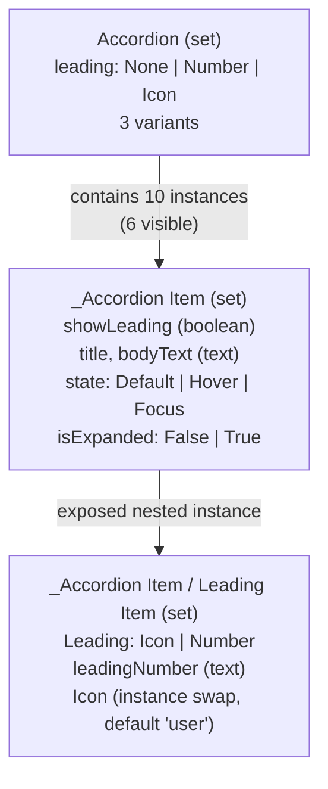

# Fidelity audit: nested components, Accordion and ActionListItem

Phase 1 of the fidelity work (13 November 2026). Evidence comes from Figma's REST data for the Blade Design System (community copy, file `3jauvx171CHyyXCixmHoY0`, version 2421258213307436575), the ds-sync intermediate model (IR), the generated React code, and the generated Storybook. Nothing here has been changed yet.

**How to read this.** "Generated code" is the implementation: ds-sync generates the components from Figma, so a code discrepancy is a generator defect or a generator limitation, never a hand-written divergence. Section 7 asks whether your organisation also has a hand-written component library that should be compared.

## 1. Summary

| # | Finding | Category | Root cause | Scope |
| --- | --- | --- | --- | --- |
| F1 | Accordion's None / Number / Icon variants all render the same: no leading element | E + D | Parent variant overrides on nested and grand-nested instances are not modelled | 109 of 332 nested instance layers in Blade (33%) |
| F2 | AccordionItem can never show an Icon; it is hard-wired to Number | C | Figma "exposed nested instances" (the item's official API) are ignored | 32 of 108 Blade sets (58 exposed layers) |
| F3 | The leading Icon shows on a grey square ("highlighted") | B (defect) | A boolean-operation shape (the icon glyph's mask) is drawn as a filled rectangle | 2,547 boolean shapes, 764 vectors |
| F4 | ActionListItem red rows | A | Figma's `isDestructive=True` Hover/Focus variants (9% red tint). Correctly rendered; not easy to find in Figma | 8 variants |
| F5 | Storybook grids show 144 ActionListItem combinations; Figma defines 26 | B | Matrix stories combine every axis value | Every set with sparse variants |
| F6 | "ActionListItemProps", "AccordionProps" etc. appear as stories | D (defect) | A type re-export in each stories file is indexed as a story | Every generated component |
| F7 | Docs pages use raw Figma names ("contentType and state", "isDisabled", "Options") and lack overview, usage, composition, accessibility | D | The docs template is a technical dump | Every component |
| F8 | Accordion has no expand/collapse; Blade checkbox/radio/button have no native behaviour | E | Behaviour templates are matched by the first design system's naming | Blade's interactive components |
| F9 | Accordion renders five fixed sample items; it cannot take your own items | C/E | No composition model for list-like parents | Accordion, ActionListItemGroup, Table, RadioGroup-like sets |
| F10 | Every Number item reads "1." | F | Figma sample text; whether numbers count up is undocumented | Accordion (Number) |

Categories: **A** design-approved, **B** implementation-only, **C** design-only, **D** documentation-only, **E** behavioural, **F** unknown (see [STANDARD.md](STANDARD.md#5-discrepancy-classification-and-decisions)).

## 2. Case study: Accordion

### 2.1 What Figma defines

Three component sets form the Accordion family:

How each Accordion variant configures its items (from the instances' properties in Figma):

| Accordion `leading` | Item `showLeading` | Nested Leading Item `Leading` | Nested `leadingNumber` | Nested `Icon` |
| --- | --- | --- | --- | --- |
| None | false | (hidden) Icon | "1." | user |
| Number | true | Number | "1." | user |
| Icon | true | Icon | "1." | user |

Design intent, as Figma states it:

- `leading` is a **parent-level configuration that flows into every item**: it switches `showLeading` on the item and the variant of the item's nested Leading Item.
- The Leading Item is an **exposed nested instance** of the item. In Figma this is an explicit design decision: its properties (`Leading`, `leadingNumber`, `Icon`) are part of the item's property panel, that is, part of the item's API.
- The default configuration is **None**: `Accordion.leading` defaults to None. The item's own default is `showLeading=true` with a Number leading (that is how the item component itself is drawn).

### 2.2 What the generated code does

| Component | Generated behaviour | Matches Figma? |
| --- | --- | --- |
| `Accordion` | `leading` prop sets an attribute only; renders 5 fixed items with `showLeading={false}` | **No.** All three values look the same (verified in Storybook) |
| `AccordionItem` | Renders the nested Leading Item hard-coded as `leading="number"`; exposes `showLeading`, `title`, `bodyText`, `state`, `isExpanded` | **Partly.** The Icon leading and custom number/icon are unreachable |
| `AccordionItemLeadingItem` | `leading` = icon / number; the Icon variant draws the icon on a grey rectangle | **No** for Icon (see F3) |
| Behaviour | `isExpanded` is a visual prop; clicking does nothing | **No** (Blade documents an expandable accordion) |

### 2.3 Root causes

1. **Instances are leaves in the IR.** For a nested instance, ds-sync keeps its own text and boolean properties (and, since the visual check, text and icons that change per variant). It does not keep (a) the variant of instances nested inside it, (b) exposed-instance properties, or (c) instance-swap values. So a parent cannot configure a grandchild.
2. **Exposed nested instances are ignored.** Figma marks them (`isExposedInstance`), but the generator never adds their properties to the component's API.
3. **Nested props are frozen to the default variant.** Even direct nested instances get the props they have in the parent's default variant, unless the change is a text or an icon.
4. **No composition model.** A parent that contains repeated items renders Figma's sample copies; there is no `children` API and no way for a parent configuration to reach items a developer provides.
5. **Shapes are approximated as boxes.** The Leading Item's icon is drawn inside a boolean operation whose fill is the glyph colour. A box with that fill reads as a highlight.

### 2.4 Answers to the questions asked

| Question | Answer, with evidence |
| --- | --- |
| Are all three configurations implemented correctly? | No. None, Number and Icon render identically in the generated Accordion. |
| Do nested components inherit the parent's properties? | No. Neither `showLeading` nor the nested `Leading` follows `Accordion.leading`. |
| Is the default state accurate? | The Accordion's default (`leading=None`) happens to match, because nothing is shown in any configuration. AccordionItem's default (Number) matches Figma's item default. |
| Is the icon highlighting intentional? | **No, it is an implementation error.** Figma draws a grey icon (the boolean shape's fill is the glyph colour) with no background; the generator draws a grey square behind a dark icon. |
| Does behaviour match Figma? | No: Blade's Accordion is generated as visuals only (no expand/collapse, no keyboard), because the accordion behaviour template looks for the first design system's layer names. |

## 3. Case study: ActionListItem

### 3.1 What Figma defines

One set, `_ActionListItem`, with 6 variant properties (`contentType`, `selectionType`, `state`, `isDisabled`, `isSelected`, `isDestructive`), 4 booleans and 2 texts, plus two nested building blocks (Leading Item, Trailing Item) and a group set (`_ActionListItemGroup`). Figma defines **26 variants** of the 144 possible combinations.

### 3.2 The red rows

The red rows are **Figma's own `isDestructive=True` variants**. Destructive Hover and Focus have a 9% red background (`#d92d20` at alpha `17`); destructive Default is transparent; destructive text is red (`#d92d20`), and destructive disabled text is red at 32% alpha.

| Figma variant (node, open in Figma) | Background |
| --- | --- |
| [destructive, Hover](https://www.figma.com/design/3jauvx171CHyyXCixmHoY0/?node-id=71630-106236) | `#d92d2017` |
| [destructive, Focus](https://www.figma.com/design/3jauvx171CHyyXCixmHoY0/?node-id=71630-106673) | `#d92d2017` |
| [destructive, Hover, selected](https://www.figma.com/design/3jauvx171CHyyXCixmHoY0/?node-id=72004-107532) | `#d92d2017` |
| [destructive, Focus, selected](https://www.figma.com/design/3jauvx171CHyyXCixmHoY0/?node-id=72004-107516) | `#d92d2017` |
| [destructive, Default](https://www.figma.com/design/3jauvx171CHyyXCixmHoY0/?node-id=71630-105689) | transparent |

**Classification: A (design-approved), semantic destructive variant.** Not legacy, not an error, not undocumented. It is hard to find because the variants sit in the component set's grid, not on the documentation frames. The documentation gap is real: the docs page should present `isDestructive` as "Destructive (for actions such as Delete)", with these states, and link to these nodes.

### 3.3 The real ActionListItem discrepancy: computed combinations (F5)

The generated stories combine every value of two properties in a grid. For ActionListItem that shows many combinations Figma never designed (118 of 144 are undesigned), styled by the generator's "nearest defined style" rule. These are **implementation-only (B)**: plausible, but not approved. They should not be presented as design variants (see the standard, section 4.4).

## 4. Storybook structure (all components)

| Issue | Example | Category |
| --- | --- | --- |
| A type export appears as a story | "ActionListItemProps", "AccordionProps", "BadgeProps" | D (defect) |
| Story names are Figma property names | "Leading", "IsDestructive", "ContentTypeAndState", "Options" | D |
| Hierarchy repeats the component name | "Components / ActionListItem / ActionListItem" | D |
| Test-only stories mixed with documentation | "Figma Variants", "DisabledDoesNotToggle" | D |
| Building blocks shown like public components | "AccordionItemLeadingItem", "CheckboxBase", "TableCellBase" | D / F (are they public?) |
| Docs page: no overview, usage, anatomy, composition, accessibility or code sections; raw headings | every component | D |
| Props table descriptions are "Figma: <name>" | every component | D |

## 5. Library-wide measurements (Blade)

| Measure | Value |
| --- | --- |
| Component sets | 108 |
| Sets with exposed nested instances | 32 (58 exposed layers) |
| Nested instance layers | 332 |
| Nested layers whose variant or properties change between parent variants | 109 (33%) |
| Instance-swap properties | 43 (not exposed as props) |
| Shape layers drawn as boxes | 2,547 boolean operations, 764 vectors, 141 ellipses, 64 lines |
| Fonts | Inter (loaded), TASA Orbiter Display (1,280 text layers, **not loaded**), Menlo, SF Pro Text, Lato |
| Visual check, 10-component sample | 87 of 268 variants match, 93 close, 88 differ |

## 6. The first design system

The same root causes exist in "Design system AI" but matter less: its nested parts are mostly text, icons and direct instances, which earlier fixes cover. Its visual check is 910 of 1,340 variants matching. Phase 3 changes are generator changes, so both systems are regenerated and remeasured.

## 7. Open questions

1. **Is there a hand-written implementation to compare?** If your organisation has a coded component library (for Blade, Razorpay's `@razorpay/blade` React package exists), "implementation-only" and "behavioural" discrepancies mean something different: the comparison becomes Figma vs your code vs Storybook (the "existing codebase" mode, not built yet). Today's implementation is generated from Figma.
2. **Leading numbers.** Should Number leadings count up (1., 2., 3.) in a real Accordion? Figma only shows "1.".
3. **Building blocks.** Are sets named with a leading underscore or "Base" (`_Accordion Item`, `CheckboxBase`, `_Table/ Cell-Base`) public components developers use directly, or internal parts that should appear only under the parent's "Composition" section?
4. **Undesigned combinations.** For ActionListItem, are combinations such as destructive + multiple-selection valid but undrawn, or invalid?
5. **Which design system is the target?** This audit uses Blade. If the target is your organisation's own file, the same audit should run on it first; the standard is designed to be file-independent.
