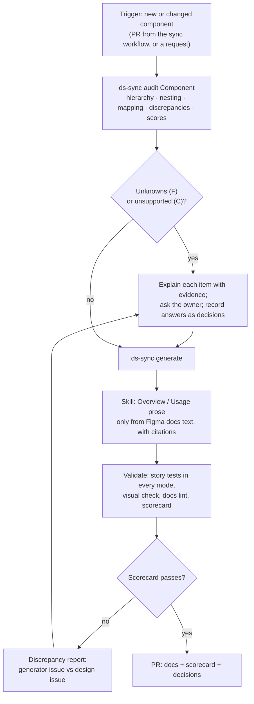

# Storybook Documentation Skill: specification

A reusable Claude Skill that audits, documents and validates a component whenever it is created or changes, enforcing [STANDARD.md](STANDARD.md) and [QUALITY.md](QUALITY.md) every time.

## 1. Design position

**Deterministic first, AI only for judgement.** Everything that can be computed (hierarchy, nesting, mappings, discrepancies, stories, docs structure, scores) is computed by ds-sync the same way every time. The skill uses AI only where a person's judgement is needed, and it never fills a gap with an invention.

| Step | Done by | Why |
| --- | --- | --- |
| 1 Inspect hierarchy | ds-sync `discover` / IR | Deterministic from Figma |
| 2 Parent and nested relationships | ds-sync nested mapping | Deterministic from instance data |
| 3 Figma specifications and tokens | ds-sync extract, variables export | Deterministic |
| 4 Implementation and existing stories | ds-sync (generated code); for a hand-written library, ds-sync's code analysis | Deterministic |
| 5 Compare design, implementation, docs | ds-sync `audit` (new): discrepancy matrix A–F | Deterministic rules |
| 6 Missing variants, wrong defaults | ds-sync `audit` | Deterministic |
| 7 Generate standard documentation | ds-sync templates (structure, examples, tables) **+ skill** for prose that has a source (rewording Figma docs text into Overview and Usage, citing the frame) | Structure must be identical everywhere; prose needs language skill but no invention |
| 8 Create or update stories | ds-sync | Deterministic |
| 9 Validate accessibility and behaviour | ds-sync tests (axe, play functions), visual check | Deterministic |
| 10 Discrepancy report and unresolved decisions | ds-sync report **+ skill** to explain each item, ask the owner, and record answers as decisions | Needs conversation with people |

## 2. Guardrails

The skill must:

- **Never invent** variants, properties, states, defaults, usage guidance, copy or behaviour. Every statement it writes cites a source: a Figma node, a docs frame, a decision, or a behaviour contract.
- **Flag, not guess.** When evidence is insufficient, create a category F item with the question, the evidence it has, and who should answer.
- **Never edit generated files.** It changes configuration (overrides, decisions, categories) or proposes generator changes; it regenerates, then validates.
- **Never accept an issue on its own.** Known issues, public/internal decisions and valid combinations need a named person's answer.
- **Report scores honestly**, including what was not measured.

## 3. Workflow

## 4. Inputs and outputs

**Inputs:** a component name (or "all changed"), `ds-sync.config.json` (with decisions), the Figma file (via ds-sync), the generated project, and optionally a hand-written code library.

**Outputs:**

- `.ds-sync/audit/<Component>.md`: discrepancy matrix with category, evidence, source of truth and resolution.
- Updated `decisions` in the configuration (only answers given by people).
- Regenerated component, stories and docs page.
- Scorecard and a short summary for the PR.

## 5. Packaging

- `skills/storybook-docs/SKILL.md`: the workflow above, the guardrails, and how to explain each discrepancy category.
- `skills/storybook-docs/reference/standard.md`: a pointer to the standard, so the skill and the generator enforce the same rules.
- New ds-sync commands it relies on: `ds-sync audit [<Component>]` (matrix and scorecard as JSON and Markdown) and `ds-sync docs lint` (documentation completeness).
- It complements the existing `figma-to-storybook` skill (setup and generation) rather than replacing it.
