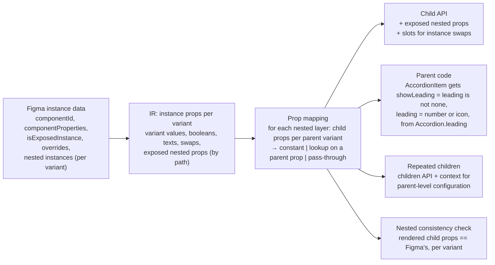

# Component documentation and fidelity standard

A repeatable standard for how every component is generated, presented and validated in Storybook, for simple components and for components with several nested levels. Proposed in Phase 2 of the fidelity work, for review before implementation.

Principles:

1. **Figma is the source of design truth; nothing is invented.** Where Figma is silent, the gap is shown and routed to a person.
2. **Generated, not hand-edited.** The standard is enforced by the generator, so every component follows it on every run. Human decisions live in configuration, not in edited files.
3. **Developers first.** A developer who has never seen a component can use it correctly from its page in five minutes.
4. **Every claim is traceable.** Every variant, property, default and state links back to a Figma node, a documented decision, or a named behaviour contract.

## 0. What this standard takes from mature documentation systems

Patterns, not content or branding, from documentation developers already know:

| System | Pattern adopted | Where it shows up here |
| --- | --- | --- |
| Storybook (Docs, Autodocs, doc blocks) | One docs page per component built from stories; Controls; stories double as tests; tags to hide test stories | Sections 2, 3, 7 |
| Bootstrap | Every example paired with its code; variants as named sections; accessibility callouts next to the feature they concern; behaviour documented as options, methods and events | Sections 3.1 (Preview, Variants, Code, Behaviour) |
| Tailwind CSS | A quick-reference table first, then basic usage, then states and responsive variants, then customisation | Properties table near the top; States and Responsive sections |
| IBM Carbon, Adobe Spectrum, Shopify Polaris, Atlassian | Usage / style / code / accessibility separation; anatomy diagrams; do and don't pairs; content guidelines; status and maturity per component | Tiers, Anatomy, Usage guidelines, scorecard |

What it deliberately does not copy: their visual design, tone or structure where it would conflict with your design language, tokens and naming. The page chrome uses your tokens; the vocabulary is your Figma's.

## 1. Source-of-truth hierarchy

When sources disagree, the higher one wins. Lower sources may add only what higher ones do not cover, and say so.

| Rank | Source | Decides |
| --- | --- | --- |
| 1 | Figma component definitions (sets, variants, properties, defaults, exposed nested instances) | What exists: variants, properties, values, defaults, nesting |
| 2 | Figma documentation frames on the component's page | Purpose, usage guidance, content guidance, accessibility notes |
| 3 | Recorded decisions (`ds-sync.config.json`, `decisions`) | Answers to open questions: public vs internal, valid combinations, naming, accepted issues |
| 4 | Behaviour contracts (WAI-ARIA patterns in `engine/archetypes/`) | Keyboard, focus, roles and states that Figma cannot express |
| 5 | Generator defaults | Only presentation mechanics (layout of story grids, wording of headings). Never design. |

If something can only be answered by rank 5, it is a gap: reported, not presented as design.

## 2. Information architecture

Three levels in the sidebar, in plain language:

```
Introduction                      (what the system is, how to install, how to read these pages)
Foundations
  Colors · Typography · Spacing · Elevation · Icons · Motion
Components
  <Category>                      (Actions, Forms, Feedback, Navigation, Overlays, Data display, Layout)
    <Component>
      Docs                        (the single documentation page, section 3)
      Playground                  (one story with every control)
      <Curated examples>          (a few named, realistic stories: "Destructive", "With icon", "In a list")
Patterns                          (optional: compositions such as forms or empty states, when Figma has them)
```

Rules:

- **Category** comes from configuration (`generate.categories`), suggested by discovery from Figma page names. No category is invented: unassigned components go under "Components" until someone assigns one.
- **One entry per public component.** Building blocks (Figma sets named `_…`, `.…`, `…Base`, or marked internal by a decision) are not listed in the sidebar; they are documented in their parent's Composition section.
- **No test-only stories in the sidebar.** Visual-check grids ("Figma Variants") and behaviour tests are tagged `!dev`: still built and tested, not shown.
- **No technical entries**: no `…Props`, no property names as story names.

## 3. The documentation page

One page per component, with anchored sections. Sections depend on the component's tier; a section with nothing to say is omitted, not filled with filler.

| Tier | Typical components | Sections |
| --- | --- | --- |
| 1 Display | Badge, Divider, Avatar, Spinner, Tag | Overview · Preview · Variants · Properties · Accessibility (short) · Code · Design reference |
| 2 Interactive | Button, Link, Checkbox, Radio, Switch, Input, Chip | Tier 1 + **States** · **Behaviour and keyboard** · **Usage guidelines** |
| 3 Composite | Accordion, ActionList, Tabs, Table, Dialog, Dropdown | Tier 2 + **Anatomy** · **Composition** (each sub-component and its properties) · **Patterns** |

Tier comes from the template (behaviour archetype = 2; nested public sub-components or a children API = 3; otherwise 1), overridable by configuration.

### 3.1 Sections

| Section | Content | Source |
| --- | --- | --- |
| Overview | One or two sentences: what it is and when to use it. When to use something else, if Figma docs say. | Figma docs frames, component description. If absent: "No description in Figma" (flagged). |
| Preview | The default configuration, interactive, with the code shown under it. | Figma default variant |
| Variants | Each design variation as a labelled example: one row per variant property, showing only **designed** values and combinations. | Figma variants |
| Properties | Table: name, type, default, description, Figma property it maps to. Grouped: Appearance, Content, State, Behaviour, Composition. | Figma properties, exposed instances, behaviour contract |
| States | Default, hover, focus, active/pressed, selected, disabled, loading, error, as designed. Pseudo states shown statically; a note says which are interactive. | Figma state axes |
| Behaviour and keyboard | What happens on click, Enter, Space, arrows, Escape; focus handling; events. | Behaviour contract |
| Usage guidelines | Do / Don't pairs. | **Figma docs only.** Never generated without a source. |
| Anatomy | The parts, numbered, from Figma's anatomy frame if present, otherwise from the layer structure, labelled as such. | Figma docs or layers |
| Composition | Which sub-components it contains, how a parent configuration flows into them, and how to supply your own children. | Nested instances, exposed instances |
| Accessibility | Role, accessible name requirement, keyboard, contrast status per mode, known issues. | Behaviour contract, axe results, decisions |
| Code | Copyable, working examples per framework (React; Web Components in HTML, Vue, Angular, Svelte). Each example is typechecked in CI. | Generated |
| Design reference | Links to the Figma component set and each variant; Figma version; fidelity score. | Figma, visual check |

### 3.2 Writing and labels

- Headings and labels in plain language: "Content type", not `contentType`; "Destructive", not `isDestructive`. The Figma property name appears in the properties table and in a "Figma:" reference, for traceability.
- Property descriptions say what the property does, in one sentence. Where only the Figma name is known: "Figma property `X`; purpose not documented in Figma" (flagged).
- Sample content comes from Figma. No invented copy in examples, except neutral placeholders labelled as such.

## 4. Naming and property conventions

### 4.1 Components

- `PascalCase` from the Figma set name, without decoration (`_`, `.`, emoji, "Base" kept only when it distinguishes a real component).
- Sub-components are named after the parent: `Accordion` and `AccordionItem`; a building block nobody uses directly stays internal.
- Web Components: `<prefix>-<kebab-name>` (`ds-accordion-item`).

### 4.2 Properties

| Figma | Code | Rule |
| --- | --- | --- |
| Variant property with named values | union of kebab-case strings (`size: 'small' | 'medium'`) | Values keep Figma's names |
| True/False variant property | `boolean` | `isDisabled`/`disabled` maps to native `disabled`; `isChecked` to `checked`; `isExpanded` to `expanded` when the behaviour contract owns it |
| Boolean property | `boolean`, Figma name camelCased (`showLeading`) | |
| Text property | `string` (or slot content) | Clashes with native attributes get a suffix (`valueText`) |
| Instance-swap property | slot prop (`icon`, `leadingIcon`) taking an icon name or element | Default: the Figma default instance |
| Exposed nested instance property | prop on the parent, named after the nested property; prefixed with the nested layer's name only on a clash | Evidence: Figma's exposed-instance flag |
| State axis (Hover/Focus/Pressed) | not a prop; CSS state; `data-force-state` for static documentation | |

### 4.3 Defaults

The default of every property is Figma's property default (`componentPropertyDefinitions`), never the first variant in the set. The **Preview** shows the component with all defaults. For nested components, the defaults are the values the nested instance has in the parent's default variant.

### 4.4 Variants and combinations

- **Designed** combinations (variants that exist in Figma) are the documentation.
- **Computed** combinations (axis values combined by the generator) may appear only in the Playground (via controls) and, when useful, in a section titled "Other combinations (not designed in Figma)", visibly marked. They are excluded from fidelity scores.
- Where a set defines few of its possible combinations, the Variants section shows the designed variants grouped by their most significant property, not a full cross-product grid.

## 5. Discrepancy classification and decisions

Every difference between Figma, the generated implementation, and the Storybook documentation is recorded with a category, evidence, a source of truth, and a resolution.

| Category | Meaning | In a generated system, usually | Default resolution |
| --- | --- | --- | --- |
| A Design-approved | In Figma and implemented | Rendered variants | Document; verify visually |
| B Implementation-only | In code, not in Figma | Computed combinations; behaviour-contract states (a focus ring Figma lacks); derived props | Keep only if traceable to rank 3 or 4; label as such; never present as a design variant |
| C Design-only | In Figma, not in code | Exposed instances, instance swaps, vector shapes, unsupported patterns | Generator backlog item; the page says what is missing |
| D Documentation-only | Storybook misrepresents the implementation | Stray stories, raw labels, identical-looking variants | Fix the documentation template |
| E Behavioural | Looks right, behaves differently | Visuals-only interactive components | Behaviour contract or generator template; until then flagged on the page |
| F Unknown | Evidence cannot decide | Undocumented intent (counting numbers, public vs internal, valid combinations) | Ask the owner; record the answer as a decision |

**Decision mechanism.** Unknowns become entries in a decisions file kept with the configuration:

```json
{
  "decisions": {
    "Accordion.leadingNumber": { "question": "Do Number leadings count up per item?", "answer": "yes, 1., 2., 3.", "by": "design-system team", "date": "2026-11-20", "source": "Figma comment / meeting" },
    "ActionListItem.combinations": { "question": "Is destructive + multiple selection valid?", "answer": "not supported", "by": "…", "date": "…" }
  }
}
```

The generator reads decisions (for example, to hide an internal building block or to restrict combinations), the audit lists unanswered ones, and nothing in category F is resolved by the generator or by AI on its own.

## 6. Nested components

### 6.1 Rules

1. A nested instance renders the **generated component** it is an instance of, never a flattened copy.
2. For every parent variant, each nested instance receives **exactly the properties Figma gives it in that variant**: its variant values, booleans, texts, instance swaps, and the properties of its own exposed nested instances.
3. Where a nested property follows a parent property, the code expresses the relationship (`showLeading={leading !== 'none'}`), not a frozen value.
4. Exposed nested instance properties are part of the parent component's API (rule 4.2).
5. A parent that repeats a child (accordions, lists, groups, tables) accepts the children as `children`. Figma's sample copies become the default example, and parent-level configuration reaches every child, including children the developer supplies, through context.
6. Hidden copies in Figma are not rendered unless a property shows them.
7. The docs page's Composition section shows the tree, which properties flow from parent to child, and a working example of supplying custom children.

### 6.2 Architecture



The mapping reuses the existing lookup mechanism (a constant, a single-property table, or one overriding value then a table), which already handles text and icons per variant, extended to every property of a nested instance.

## 7. Interactive previews and examples

- Every example is a real component render with real props; nothing is a picture.
- Controls show only the component's public properties, grouped like the properties table; state axes are not controls.
- Code under each example is the code that renders it.
- Examples in the docs are also stories, so they run as tests (render, accessibility, and play functions where behaviour applies).

## 8. Accessibility

Per component page and per test run:

- Role and accessible name requirement (who provides the name: a visible label, `aria-label`, or a field).
- Keyboard map from the behaviour contract, tested by play functions.
- axe in every Figma mode; failures are test failures unless accepted as known issues (per component and mode, with a reason and an owner).
- Contrast status per mode shown on the page.
- Focus visible: Figma's focus state, or the contract's focus ring, labelled as such.

## 9. Responsive behaviour

Only what Figma specifies: fixed, hug or fill sizing, wrapping, min and max widths, and responsive variants (for example Blade's `screenSize: Desktop | Mobile` and `…Desktop` / `…Mobile` text layers). Where Figma has responsive variants, the page shows them side by side and the Playground offers a viewport toggle. Nothing responsive is invented.

## 10. Design-to-code traceability

Each generated component carries a `<Component>.figma.json` with the Figma node ids of its set and variants, its property mapping (Figma property → prop, with the rule used), its nested mapping (child, property, per-variant values), its decisions, and its fidelity scores. The docs page renders the human-readable part; CI uses the rest.
